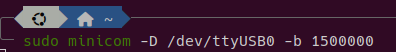
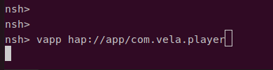
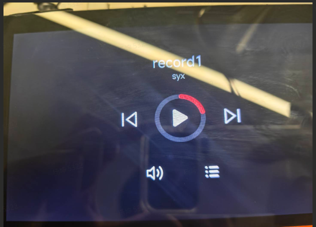

# Quick App Development Guide (Manual Development)

\[ English | [简体中文](../../../zh-cn/app_dev/quickapp/quickapp_manual.md) \]

> This guide helps developers go through the whole Xiaomi Vela quick app flow in the shortest time: environment setup, project creation, development and debugging, packaging for release, and deployment on real hardware.

> If you'd rather have AI generate and debug the code for you, see [Quick App Development Guide (AI Workflow)](./quickapp_ai_workflow.md).

## I. Creating Your First Project

### 1. Steps

1. Open the AIoT IDE and click "File" > "New Project".
2. Select **watch** on the left and click "Create".
3. Choose a project template and click "Next".
4. Enter the project name and save location, then click "Create".

### 2. Project Directory Structure

```
├── package.json         # Project configuration
├── sign/                # Signing files (for release packaging)
└── src/                 # Source directory
    ├── app.ux           # App entry (global lifecycle, global data)
    ├── manifest.json    # App configuration (package name, version, permissions, routes)
    ├── common/          # Shared resources (components, images, scripts)
    ├── i18n/            # Multi-language configuration
    └── pages/           # Pages directory (one subdirectory per page)
```

### 3. Core Files

| File                   | Purpose                                                                      |
| ---------------------- | ---------------------------------------------------------------------------- |
| `src/manifest.json`    | Declares the app's basic information, system API permissions and page routes |
| `src/app.ux`           | App entry; defines global lifecycle callbacks and global data                |
| `src/pages/xxx/xxx.ux` | Page file, made of three parts: template + style + script                    |

---

## II. Running and Debugging

### 1. Configure the Emulator

1. In the AIoT IDE, click the "Emulator" button in the banner bar.
2. Click "New" and select the **vela-watch-5** image.
3. Enter an emulator name and click "New".

### 2. Run the Project

Click the "Select Device" button in the banner bar and choose the emulator you just created.

### 3. Debug the Project

Click the "Debug" button in the banner bar. A debug panel opens at the bottom and supports:
- **DOM tree view**: inspect the page structure and styles.
- **Console**: view the log output.
- **Breakpoint debugging**: step through the code to locate problems.

---

## III. Packaging

### 1. Development Mode Packaging

Click the "Package" button in the banner bar to generate `dist/xxx.debug.rpk`.

> Note: debug.rpk is only for development and debugging. For a formal release, use release.rpk (production mode packaging).

### 2. Production Mode Packaging (for Release)

1. **Generate a signature**: click the "Release" button, fill in the information, and the signing files are generated automatically.
2. **Package**: click "Release" again to generate `dist/xxx.release.rpk`.

---

## IV. Deploying to the openvela Emulator

> **The difference between the two emulators**: the AIoT IDE built-in emulator is for quick previews and debugging during development; the openvela emulator validates the app in a real openvela system environment (closer to real hardware behavior). If you only want a quick look at the result, Section II is enough; to validate a real deployment, use this section.

### 1. Prepare the Emulator Environment

Follow [Quick Start (Ubuntu)](../../quickstart/openvela_ubuntu_quick_start.md) to set up and build the openvela emulator runtime environment.

### 2. Start the Emulator

This section uses the `vela_goldfish-arm64-v8a-ap` emulator as the example. Start it with the following command (replace the path with your actual build output):

```bash
./emulator.sh cmake_out/vela_goldfish-arm64-v8a-ap/
```

Once started, `emulator.sh` occupies the current terminal and keeps printing emulator logs. Leave that terminal running and **open another terminal** on the host (your Ubuntu machine) for the `adb` commands that follow.

After the emulator has fully started, run `adb devices` in the new terminal to confirm the device is connected (the device name is usually `emulator-5554`; if another emulator holds that port it may be `emulator-5556` or similar, so use the name actually shown in later commands):

```bash
adb devices
```

> Note: every `adb` command in this section runs in a terminal on the **host**. `adb` sends the commands into the emulator over its channel, so there is no need to "enter" the emulator by hand.

> Important: adb on the openvela arm64 emulator only supports push/pull file transfers. Interactive adb shell commands (such as ls, mkdir, vapp) return error: closed, which is expected. When you need to run a command on the device, type it directly in the emulator's serial console (the terminal running emulator.sh, showing the goldfish-armv8a-ap> prompt).

### 3. Install the Font Package

The emulator has no Chinese fonts by default. Download the font package, extract it and push it manually with the commands below:

> Font package download: [font.zip](../../../zh-cn/app_dev/quickapp/attachment/font.zip)

```bash
# You can download font.zip to any directory; extracting it gives a font folder (containing .ttf files such as MiSans and simhei)
# Note: the command below works relative to the current directory. First cd to the parent directory of the font folder (so that font is visible in the current directory), then run:
adb -s emulator-5554 push ./font /data/
```

> A successful push prints something like `xx files pushed, xx bytes in xxs`, and the fonts end up in the device's `/data/font/` directory. Because adb shell is unavailable, you can't verify this with `adb shell ls`; the push output is enough.

### 4. Extract and Push the App

This section uses the generated `com.vela.player.release.1.0.0.rpk` as the example (replace it with your own app's rpk file name; the package name must match the `package` field in `manifest.json`):

```bash
# 1. Extract the rpk (an rpk is essentially a zip file)
unzip com.vela.player.release.1.0.0.rpk -d com.vela.player

# 2. Push the app (note: the target path must include the full package name, so that manifest.json sits under /data/app/<package name>/)
adb -s emulator-5554 push com.vela.player /data/app/com.vela.player
```

### 5. Start the App

In the emulator's serial console (the terminal running emulator.sh), enter:

```bash
vapp hap://app/com.vela.player
```

> Note: `adb shell vapp ...` doesn't work on the arm64 emulator (it returns error: closed). You must type the command directly in the serial console.

> Runtime environments: `packages_apps` runs on the openvela emulator; `packages_fe_examples` runs in the AIoT IDE built-in emulator and is for learning reference only.

## V. Deploying to a Development Board

This section uses the Rivotek 7-inch MIPI display development board (R528S3-Gemini-S1) as the example and walks through the whole flow from firmware packaging to running the app.

> Prerequisites: you have pulled the board SDK, set up the build environment and built the firmware. Follow [Quick Start (Ubuntu)](../../quickstart/openvela_ubuntu_quick_start.md) to set up the environment and pull the code; build instructions are below.

### 1. Board Build Instructions

**SDK directory structure:**

```
vendor/allwinnertech/
├── apps/              # Core apps and demos
├── boards/            # Board support packages (startup code, pin configuration)
│   └── r528/
│       └── r528s3-gemini-s1/  # Core directory for this board
├── chips/             # Chip-level drivers (GPIO, SPI, TWI, etc.)
│   └── r528/
│       ├── drivers/   # Low-level HAL and RTOS adaptation layer
│       └── drv/       # NuttX driver implementation layer
├── lichee/            # Firmware packaging and production tools
├── Make.defs          # Global build rules
└── Kconfig            # Global configuration entry
```

**Build commands (7-inch MIPI display):**

```bash
# Optional: clean only after menuconfig changes
./build.sh vendor/allwinnertech/boards/r528/r528s3-gemini-s1/configs/nsh/ -j8 distclean

# Build
./build.sh vendor/allwinnertech/boards/r528/r528s3-gemini-s1/configs/nsh/ -j8
```

### 2. Configure Fonts

Create a `font` folder under `vendor/allwinnertech/lichee/board/common/data/UDISK` and copy all font files from the font package into `font`.

> Font package: [font.zip](../../../zh-cn/app_dev/quickapp/attachment/font.zip)

### 3. Deploy the App Files

1. Create an `app` folder under `vendor/allwinnertech/lichee/board/common/data/UDISK/`.
2. Extract the rpk file and put the extracted app folder into that directory:

```bash
unzip com.vela.player.release.1.0.0.rpk -d com.vela.player
cp -r com.vela.player vendor/allwinnertech/lichee/board/common/data/UDISK/app/
```

### 4. Package the Firmware

```bash
# Run the following commands in order in a bash terminal
cd vendor/allwinnertech/lichee/
source envsetup.sh
lunch_nuttx  # select 2 r528s3-gemini-s1
pack
# The packed image is at vendor/allwinnertech/lichee/out/r528s3/gemini-s1_nand/rtos_nuttx_r528s3-gemini-s1_uart0_128Mnand.img
```

> Packaging takes only a few minutes and doesn't rebuild the kernel. You only need to run build.sh again after changing the defconfig or the source code.

### 5. Flash and Start the App

After flashing the firmware to the board, open the nsh shell through a serial terminal:

```bash
# Open the serial port from a bash terminal
sudo minicom -D /dev/ttyUSB0 -b 1500000
```



In the nsh terminal, start the quick app:

```bash
# Start the quick app from the nsh terminal
vapp hap://app/com.vela.player
```



> Once it starts, your app's UI appears on the board's screen.



---

## VI. FAQ

### Q1: No Device Listed by adb devices for the Emulator

**Cause**: the emulator hasn't fully started, or the adb service is misbehaving.
**Solution**: wait for the emulator to finish starting, or run `adb kill-server && adb start-server`.

### Q2: Blank Screen or Garbled Chinese Text After the App Starts

**Cause**: the Chinese font files are missing.
**Solution**: make sure the font package is installed in the `/data/font/` directory.

### Q3: Can not load manifest.json

**Cause**: the app files weren't deployed to the `/data/app/<package name>/` directory correctly.
**Solution**:
1. Check the directory structure: `/data/app/com.vela.player/manifest.json` must exist.
2. Check that the cp command ran successfully.
3. The cp in NuttX nsh doesn't support the `*` wildcard; use full paths.

### Q4: vapp Reports That the App Can't Be Found

**Cause**: the package name doesn't match, or the path is wrong.
**Solution**: make sure the package name in the start command is exactly the same as the `package` field in `manifest.json`.

### Q5: cp -r Fails on the Development Board

**Cause**: the cp implementation in NuttX nsh has limitations.
**Solution**: use full paths and no wildcards:

```bash
cp -r /resource/app/com.vela.player /data/app/com.vela.player
```

### Q6: Changes Don't Take Effect After Updating the App

**Solution**:
- Emulator: run `rm -rf /data/app/com.vela.player` in the serial console, then push again with adb push.
- Development board: repackage and reflash, or run `rm -rf /data/app/com.vela.player` in nsh and cp the app again.

### Q7: Wrong App Directory Structure After adb push (manifest.json Directly Under /data/app/)

**Cause**: when you run `adb push com.vela.player /data/app/` and the `/data/app/` directory doesn't exist, adb renames the source directory to the target path, so the files land directly in `/data/app/` without the package-name subdirectory.

**Solution**: specify the full target path when pushing:

```bash
adb -s emulator-5554 push com.vela.player /data/app/com.vela.player
```

Confirm that the final structure is `/data/app/com.vela.player/manifest.json`.

---

## Appendix

### A. Quick Apps vs. LVGL Native Apps

| Feature        | Xiaomi Vela quick app                           | LVGL native app                                    |
| -------------- | ----------------------------------------------- | -------------------------------------------------- |
| Language       | HTML/CSS/JavaScript                             | C/C++                                              |
| Learning curve | Low (front-end tech stack)                      | High (embedded development experience)             |
| Deployment     | Push an rpk package; no firmware rebuild needed | Built into the firmware; requires reflashing       |
| Use cases      | UI-interaction apps, rapid prototyping          | High-performance needs, low-level hardware control |

### B. Related Resources

- openvela quick app website: https://iot.mi.com/vela/quickapp/
- AIoT IDE download: https://iot.mi.com/vela/quickapp/zh/guide/start/use-ide.html
- openvela GitHub: https://github.com/open-vela
- LVGL official documentation: https://lvgl.io/documentation
