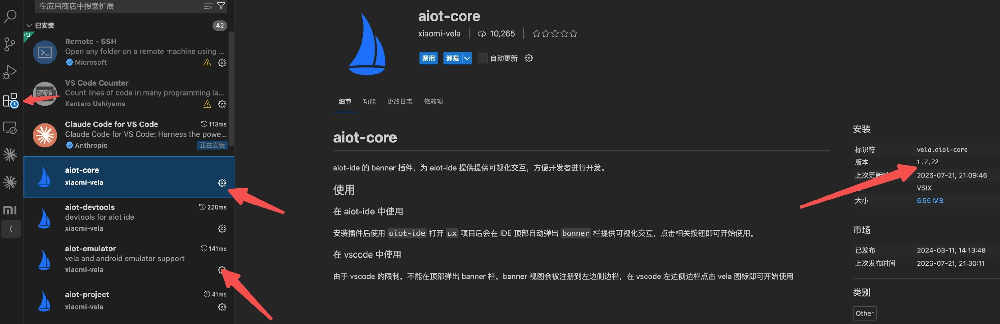
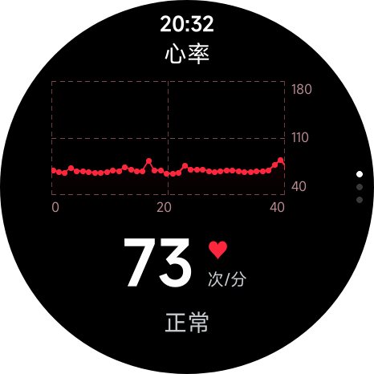
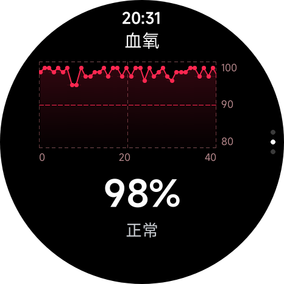
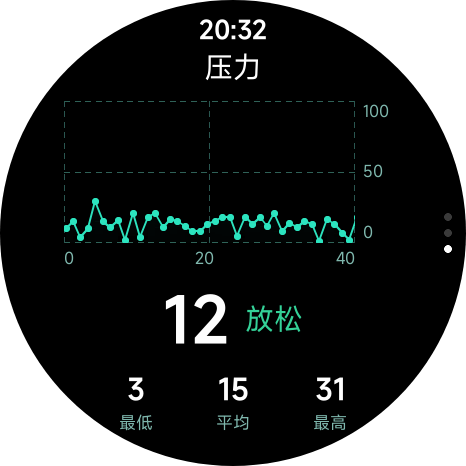

# openvela Quick App Health Data API (service.health) Guide

\[ English | [简体中文](../../../zh-cn/app_dev/quickapp/service_health_guide.md) \]

> This guide explains how to read watch health data (heart rate / blood oxygen / stress) from a quick app through `service.health`.

## I. Overview

`service.health` lets an openvela quick app read the watch system's health data streams directly: **heart rate, blood oxygen and stress**. Developers **don't need to deal with the underlying sensors**; a single line of JS subscribes to real-time data.

**Typical use cases (for reference only):**

- **Watch face health cards**: keep the current heart rate, blood oxygen and stress on the wrist, with a simple trend curve.
- **Health care apps**: collect the heart rate of elderly people or children over time and raise local or cloud alerts on anomalies; work with smart home devices for household-level care.
- **Real-time fitness feedback**: show the live heart rate and zone hints while running or cycling.
- **Stress reminder apps**: pop up a breathing and relaxation guide when the stress value stays high.

**Current version scope**: only 3 **sample-family APIs** (`getRecentSamples` / `subscribeSample` / `unsubscribeSample`) and 3 **data types** (HEART_RATE / SPO2 / STRESS) are available. Sleep and summary APIs are planned for later versions.

## II. Running the Minimal Example

**Getting and using it**: the release package will be integrated into the IDE. Developers only need to start the matching emulator in the IDE; `service.health` and the mock data for debugging are built into the emulator, so nothing has to be installed by hand.

**IDE plugin version requirement**: before using `service.health`, update both the `aiot-core` and `aiot-emulator` plugins in the IDE to **1.7.22 or later**. Older versions prevent the `service.health` module from loading, or leave the emulator's built-in health data playback unavailable.

- **How to update**: open the IDE Extensions panel, search for `aiot-core` and `aiot-emulator`, and click "Update" on each to get 1.7.22+.



**Emulator image requirement**: when you create an emulator in the IDE, choose an image version that includes the `service.health` module and the health data playback for debugging. An image without that module leaves `service.health` unable to load or without any data playback.

**Prerequisite checklist:**

- Add the permission to `manifest.json`: `hapjs.permission.HEALTH`
- Add the feature to `manifest.json`: `service.health`
- Import it in JS: `import health from "@service.health";`

**manifest.json snippet:**

```json
{
  "package": "com.example.health.demo",
  "deviceTypeList": ["watch"],
  "features": [
    { "name": "service.health" }
  ],
  "permissions": [
    { "name": "hapjs.permission.HEALTH" }
  ],
  "config": {
    "designWidth": 480,
    "background": {
      "features": ["service.health"]
    }
  }
}
```

**Field descriptions:**

- `deviceTypeList: ["watch"]`: declares that the app runs on watch devices only. Required.
- `features` + `permissions`: declare the `service.health` module and the health data permission. **Both must be declared.** Declaring features without permissions gets the call rejected by permission control; declaring permissions without features means the module can't be loaded.
- `config.designWidth: 480`: the design width of a round watch face (health-demo uses 480; if your target is a square screen, change it to match).
- `config.background.features: ["service.health"]`: **this is what makes background running work** (see Section VII). Only when it is declared here does `subscribeSample` keep calling back after the app goes to the background. If you only declare it under features and leave out background, callbacks stop once the app is in the background.

**Minimal runnable JS (subscribe to heart rate and keep receiving data):**

```javascript
import health from "@service.health";

export default {
  onReady() {
    health.subscribeSample({
      dataType: health.DATA_TYPES.HEART_RATE,
      callback: (sample) => {
        // sample = { timeStamp: <milliseconds>, value: <bpm> }
        console.log(`心率: ${sample.value} bpm @ ${new Date(sample.timeStamp).toLocaleTimeString()}`);
      },
      fail: (data, code) => {
        console.log("订阅失败 code:", code);
      },
    });
  },
  onDestroy() {
    health.unsubscribeSample({ dataType: health.DATA_TYPES.HEART_RATE });
  },
};
```

**What do you see in the AIoT IDE emulator?**

- The console prints 1 log line per second, with the heart rate fluctuating realistically between **48 and 182 bpm** (looped playback of 31 days of real human data).
- After switching to the background, the callback keeps firing; when you return to the foreground, the data has moved forward.

**Want to run the full example?** See [health-demo](https://github.com/open-vela/packages_apps/tree/dev-ai-contest-2026/wearable/health-demo) (three cards for heart rate / blood oxygen / stress, plus trend curves).

## III. Supported DATA_TYPES

The current version supports sampling for the following 3 types; other types are not supported yet.

| Name       | Value | value type / unit           |
| ---------- | ----- | --------------------------- |
| HEART_RATE | 0     | Int, bpm (heart rate)       |
| SPO2       | 6     | Int, % (blood oxygen, SpO2) |
| STRESS     | 9     | Int (stress value)          |

- Read the values through `health.DATA_TYPES.HEART_RATE` and so on.
- `timeStamp` is always a **millisecond epoch timestamp** and can be parsed directly with `new Date(timeStamp)`.
- Unsupported types: `getRecentSamples` skips them, and `subscribeSample` triggers `fail` with `code === 203` (see the error codes in Section VI).

## IV. Debug Environment Data (QEMU)

In the debug environment (the AIoT IDE built-in emulator), health data is driven by a **mock publisher** built into the emulator firmware. It loops **about 31 days of real health data from a real person** to make integration testing easier.

**Key characteristics:**

- **Publishing rate: every type is reported continuously at 1 Hz (1 sample per second).**
  - **HEART_RATE / SPO2**: 1 Hz matches the actual output rate of a real device in "foreground / continuous measurement" mode.
  - **STRESS**: about once every 60 s on a real device; the debug environment **speeds it up to 1 Hz** (about 60x) for easier testing. In the debug environment this type is therefore **faster than on a real device**. It is meant for debugging only and doesn't reflect the real device's pace.
- **timeStamp behavior**: generated from the **current device time** at publishing, so it is **close to "now" and monotonically increasing**, and can be passed directly to `new Date(timeStamp)`.
- **Value ranges** (from the real human data):

| Type       | value range  |
| ---------- | ------------ |
| HEART_RATE | bpm 48 ~ 182 |
| SPO2       | 90 ~ 99 %    |
| STRESS     | 1 ~ 49       |

## V. API Reference

### 5.1 health.getRecentSamples(OBJECT)

Gets the most recent sample of each requested type (one-shot, not a subscription).

| Parameter | Type              | Required | Description                                           |
| --------- | ----------------- | -------- | ----------------------------------------------------- |
| dataTypes | Array<DATA_TYPES> | Yes      | Array of data types to query                          |
| success   | Function          | No       | Success callback; the argument is an array of results |
| fail      | Function          | No       | Failure callback `(data, code)`                       |
| complete  | Function          | No       | Completion callback                                   |

success returns an array. Each item looks like this:

```text
{ dataType: <DATA_TYPES>, data: { timeStamp: <milliseconds>, value: <depends on dataType> } }
```

**Behavior:**

- Only the types that **can be found** are returned. If none of the requested types can be found, an **empty array** is returned (still through success).
- Unsupported types are **ignored** (they don't trigger fail).

**Two calling styles**: besides the `success` / `fail` callback style below, `getRecentSamples` also **returns a Promise natively**. The health-demo example uses the Promise form:

```javascript
// Promise style (used by health-demo)
health
  .getRecentSamples({ dataTypes: [health.DATA_TYPES.HEART_RATE, health.DATA_TYPES.SPO2] })
  .then((list) => {
    // list = [{ dataType, data: { timeStamp, value } }, ...]
    console.log(JSON.stringify(list));
  })
  .catch(() => {});
```

The equivalent callback style:

```javascript
import health from "@service.health";

health.getRecentSamples({
  dataTypes: [health.DATA_TYPES.HEART_RATE, health.DATA_TYPES.SPO2],
  success: (data) => {
    // data = [{ dataType: 0, data: { timeStamp: 1750000000000, value: 73 } }, ...]
    console.log(JSON.stringify(data));
  },
  fail: (data, code) => { console.log("fail:", code); },
});
```

### 5.2 health.subscribeSample(OBJECT)

Subscribes to a type and keeps calling back whenever the data updates.

| Parameter | Type       | Required | Description                             |
| --------- | ---------- | -------- | --------------------------------------- |
| dataType  | DATA_TYPES | Yes      | A single data type                      |
| callback  | Function   | Yes      | Data callback; the argument is a Sample |
| fail      | Function   | No       | Failure callback `(data, code)`         |

Structure of the Sample passed to callback:

```text
{ timeStamp: <milliseconds>, value: <depends on dataType> }
```

```javascript
health.subscribeSample({
  dataType: health.DATA_TYPES.HEART_RATE,
  callback: (sample) => {
    // sample = { timeStamp: 1750000000000, value: 73 }
    console.log(JSON.stringify(sample));
  },
  fail: (data, code) => { console.log("fail:", code); },
});
```

### 5.3 health.unsubscribeSample(OBJECT)

Cancels the subscription for a type.

| Parameter | Type       | Required | Description                   |
| --------- | ---------- | -------- | ----------------------------- |
| dataType  | DATA_TYPES | Yes      | Data type to unsubscribe from |

```javascript
health.unsubscribeSample({ dataType: health.DATA_TYPES.HEART_RATE });
```

## VI. Error Codes

| code | Meaning                                                              |
| ---- | -------------------------------------------------------------------- |
| 200  | General / system error                                               |
| 202  | Invalid parameter (e.g. dataTypes missing or an empty array)         |
| 203  | Not supported (the dataType is not supported in the current version) |

**How each API handles unsupported types:**

- `getRecentSamples`: **skips** unsupported types (if every requested type is unsupported, it returns an empty array through success and doesn't report 203).
- `subscribeSample`: triggers **fail with code = 203** for unsupported types.

## VII. Background Running Notes

A `subscribeSample` subscription **keeps calling back after the app goes to the background**, which suits continuous background collection.

- Subscribe once. The `callback` keeps arriving in both the foreground and the background, so there is no need to subscribe again in `onShow` / `onHide`.
- Call `unsubscribeSample` when you no longer need the data, to avoid pointless background callbacks and power use.
- The subscription ends naturally when the app is reclaimed by the system or exits; call `subscribeSample` again after re-entering.

> Background callbacks rely on `service.health` being declared in `config.background.features` in `manifest.json` (see Section II).

## VIII. Complete Example App

Repository: [wearable/health-demo](https://github.com/open-vela/packages_apps/tree/dev-ai-contest-2026/wearable/health-demo) (in the `dev-ai-contest-2026` branch of the `packages_apps` repository, with screenshots of the three cards running).

**Highlights:**

- Three cards you can swipe up and down: **heart rate / blood oxygen / stress**, each refreshed in real time by a `subscribeSample` for its type.
- On cold start, `onReady` uses `getRecentSamples` to fill in the latest value, so the first frame isn't blank.
- The manifest declares `background.features`, so the subscriptions keep calling back in the background.
- A friendly message is shown for the `fail` of an unsupported type (`code === 203`).
- Adapted to a round watch face (`designWidth: 480`, `deviceTypeList: ["watch"]`).

**Key files:**

- `src/manifest.json`: permission and feature declarations
- `src/pages/index/health.js`: wrapper around the service.health calls (getRecent / subscribe / unsubscribe)
- `src/pages/index/index.ux`: main page and data orchestration
- `src/components/HrCard.ux` / `Spo2Card.ux` / `StressCard.ux`: the three cards

**Result (heart rate / blood oxygen / stress cards):**

| Heart rate                                                                     | Blood oxygen                                                                       | Stress                                                                         |
| ------------------------------------------------------------------------------ | ---------------------------------------------------------------------------------- | ------------------------------------------------------------------------------ |
|  |  |  |

## IX. Reporting Issues

Feedback on problems you hit during integration is welcome. To help locate them quickly, please provide the information below. **The more complete it is, the faster the problem can be found, and the most important part is a minimal case that reproduces it reliably.**

- **Problem description**: summarize the symptom in one sentence and name the API involved (`getRecentSamples` / `subscribeSample` / `unsubscribeSample`) and the data type.
- **Minimal reproduction case**: the smallest code that reproduces the problem reliably, including the permission / feature declarations in `manifest.json` and the calling snippet, with unrelated logic removed.
- **Reproduction steps**: the steps from startup to the moment the problem appears, marked "always / intermittent" (for intermittent problems, give a rough probability).
- **Expected result**: the behavior or return value you consider correct.
- **Actual result**: what actually happens, including the error `code`, the callback content and error messages, plus any necessary logs / screenshots.
- **Environment**: release package / emulator version, `aiot-toolkit` version, IDE version.

You can copy and fill in the template below:

```text
[Problem description]
[API / data type involved]
[Minimal reproduction case]
[Reproduction steps] (always / intermittent, probability)
[Expected result]
[Actual result] (error code / callback / logs / screenshots)
[Environment] (release package / emulator, aiot-toolkit, IDE version)
```

## X. Changelog

**v1.0.0**

- Opened 3 sample-family APIs: `getRecentSamples` / `subscribeSample` / `unsubscribeSample`.
- Supported 3 data types: `HEART_RATE`(0) / `SPO2`(6) / `STRESS`(9).
- Supported background subscriptions: `subscribeSample` keeps calling back after the app goes to the background.
- Unified error codes: `200` general / `202` invalid parameter / `203` not supported.
- Provided a matching minimal example quick app (heart rate / blood oxygen / stress cards).

## XI. FAQ

No common questions have been collected yet. They will be added based on developer feedback.
