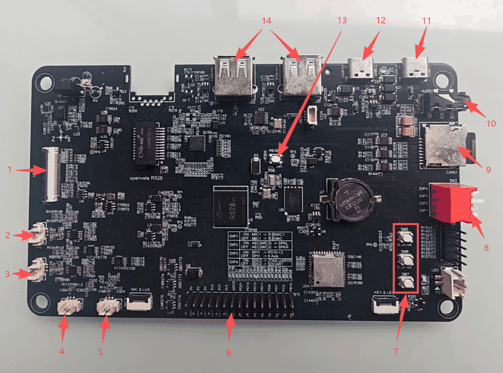
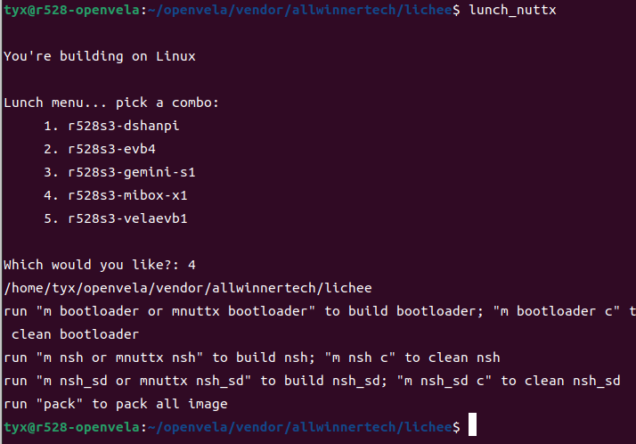
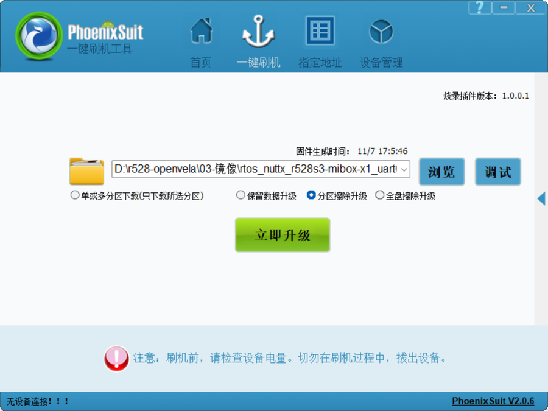

# R528 MIBOX-X1 Development Board Guide
\[ English | [简体中文](../../zh-cn/contest_hk_2026/mibox_x1_board_guide.md) | [繁體中文](../../zh-cn/contest_hk_2026/mibox_x1_board_guide_zh-hk.md) \]

> This guide covers using the R528 MIBOX-X1 development board (Allwinner R528-S3) with openvela: hardware specifications, interfaces and DIP switches, building, flashing, peripheral tests, and a first application.
>
> The board support code is in [`vendor_allwinnertech/boards/r528/r528s3-mibox-x1`](https://github.com/open-vela/vendor_allwinnertech/tree/dev-ai-contest-2026/boards/r528/r528s3-mibox-x1). For the directory layout, see its [README.md](https://github.com/open-vela/vendor_allwinnertech/blob/dev-ai-contest-2026/boards/r528/r528s3-mibox-x1/README.md).

## I. Hardware Specifications

| Item | Specification |
| ---- | ------------- |
| SoC | Allwinner R528-S3, dual-core Arm Cortex-A7, 1.2 GHz |
| Memory | 128 MB DDR3 |
| Storage | 256 MB SPI NAND (W25N02KVZEIR), TF card slot |
| Display | 480×480 MIPI DSI panel (ST7701S) |
| Touch | GT911 capacitive touch (I2C) |
| Audio | NS4150B amplifier with left and right speakers, two microphone inputs (MIC1, MIC2), 3.5 mm headphone jack |
| Wireless | Wi-Fi (SDIO) and Bluetooth (UART) |
| Sensor | ICM20948 9-axis sensor (SPI) |
| Other | Infrared transmitter and receiver, 3 LRADC buttons, PWM-dimmable LED, RTC (32.768 kHz crystal and coin cell) |
| Expansion | Header pins expose UART, I2C, SPI, PWM, ADC, and GPIO |
| Debug serial port | Onboard USB-to-serial (CH340), 1500000, 8, N, 1 |

## II. Interfaces and DIP Switches



| No. | Interface / component | Description |
| --- | --------------------- | ----------- |
| 1 | Touch screen FPC connector | Connects the MIPI DSI display and the GT911 capacitive touch panel |
| 2 | Speaker (right channel) | Right-channel speaker output |
| 3 | Speaker (left channel) | Left-channel speaker output |
| 4 | MIC2 | Second microphone input |
| 5 | MIC1 | First microphone input, switchable between an external MIC and the headset MIC |
| 6 | Header pins | Expose GPIO, ADC, UART, I2C, and SPI |
| 7 | Buttons (3) | LRADC buttons |
| 8 | DIP switch | 4 positions, see the table below |
| 9 | SD card slot | TF card, detected as `/dev/mmcsd1` |
| 10 | Headphone jack | 3.5 mm headphone output |
| 11 | USB firmware flashing / adb port | USB-D port, used for firmware flashing and adb debugging |
| 12 | Debug serial port | Onboard USB-to-serial (UART0), 1500000, 8, N, 1 |
| 13 | Reset button | RESET (SW1) |
| 14 | USB-A ports (2) | Labeled USB-H1 and USB-H2 on the board, not covered in this guide |

The DIP switch (SW3) is described below as printed on the board. The physical board takes precedence.

| Position | ON | OFF |
| -------- | -- | --- |
| DIP1 | MIC1 uses the external MIC1 input | MIC1 uses the headset MIC |
| DIP2 | Echo-reference (loopback) data comes from the left speaker channel (SPKL) | Echo-reference data comes from the right speaker channel (SPKR) |
| DIP3 | SPI1 goes to the header pins (PD10 to PD13) | SPI1 goes to the onboard 9-axis sensor |
| DIP4 | Pins are used as the UART0 debug serial port (JTAG UART0) | Pins are used for the SD card |

DIP3 and DIP4 are either-or settings. The header SPI and the 9-axis sensor cannot be used at the same time, and the UART0 debug serial port and the SD card cannot be used at the same time.

## III. Getting the Code and Building

Building requires Ubuntu 22.04. For installing the dependency packages, `repo`, and `git-lfs`, see [Quick Start (Ubuntu)](../quickstart/openvela_ubuntu_quick_start.md).

### 1. Get the Code

```bash
mkdir openvela && cd openvela
repo init -u https://github.com/open-vela/manifests.git -b dev-ai-contest-2026 -m openvela.xml --repo-url=https://mirrors.tuna.tsinghua.edu.cn/git/git-repo/ --git-lfs
repo sync -c -j4
```

`vendor/allwinnertech` is already part of the repository. You do not need to download it separately.

### 2. Build and Pack

```bash
cd vendor/allwinnertech/lichee
source envsetup.sh
lunch_nuttx          # choose r528s3-mibox-x1
m nsh                # build; use "m nsh c" to clean
pack                 # pack the firmware image
```

`lunch_nuttx` lists all R528 board packages. Choose `r528s3-mibox-x1`. It is item 4 in the screenshot below, but the number can change when new boards are added, so go by the list on your screen.



When packing finishes, the firmware image is at:

```text
vendor/allwinnertech/lichee/out/r528s3/mibox-x1_nand/rtos_nuttx_r528s3-mibox-x1_uart0_256Mnand.img
```

### 3. The Two Configurations

| Configuration | Console | SD card | Build command |
| ------------- | ------- | ------- | ------------- |
| `nsh` (default) | UART0 (onboard USB serial port) | Disabled | `m nsh` |
| `nsh_sd` | UART2 (pins PC00 and PC01) | Enabled | `m nsh_sd` |

The SD card and the UART0 debug port share pins PF2 and PF4. With `nsh_sd`, the onboard USB serial port is therefore unavailable. Connect a USB-to-serial cable to the UART2 pins, and set DIP4 to OFF.

To change the configuration (menuconfig), run the following from the SDK root:

```bash
./build.sh vendor/allwinnertech/boards/r528/r528s3-mibox-x1/configs/nsh menuconfig
```

## IV. Flashing the Firmware

Flashing is done on a Windows computer. You need three tools:

- PhoenixSuit: Allwinner's flashing tool. Unzip it and run it.
- Allwinner USB burning driver: unzip it, double-click the installer, and follow the prompts.
- CH340 driver: the driver for the onboard USB-to-serial chip, needed to see the debug serial port.

The tool package is provided with the board materials. Installing the drivers requires administrator rights.

### 1. Connect

Use a USB Type-A to Type-C cable to connect the computer to the board's USB-D port (item 11 in the interface diagram). To see the debug serial port, connect a second cable to item 12.

### 2. Flashing Steps

1. Open PhoenixSuit, click "Browse" (浏览), and select the `.img` firmware packed in the previous section. The screenshot below uses "Partition erase upgrade" (分区擦除升级).

   

2. Briefly press the SW1 (RESET) button on the board.
3. When the dialog appears, choose "Yes" (是) to start flashing.
4. When flashing finishes, unplug the flashing cable and power the board on again. With the flashing cable still plugged in, the system may not boot.

### 3. View the Serial Port

The serial port settings are 1500000 baud, 8 data bits, no parity, 1 stop bit. On Windows you can use MobaXterm or PuTTY. On Ubuntu you can use `picocom`. When you see the `nsh>` prompt, the system is running.

## V. Peripheral Tests

All commands below are run at the `nsh>` prompt with the default `nsh` configuration.

### 1. UART

Short the TX and RX pins of the serial port under test to make a loopback:

```text
nsh> echo 123456789 > /dev/uart2
nsh> cat /dev/uart2
nsh> echo 123456789 > /dev/uart4
nsh> cat /dev/uart4
```

### 2. I2C

```text
nsh> i2c dev -b 0 0 7f
nsh> i2c dev -b 2 0 7f
```

The touch controller GT911 is on I2C2. Its address should appear in the scan result.

### 3. GPIO

```text
nsh> echo 1 > /dev/gpio0
nsh> echo 0 > /dev/gpio0
```

`/dev/gpio1`, `/dev/gpio2`, and `/dev/gpio3` work the same way.

### 4. LED

```text
nsh> pwm -p /dev/pwm1 -d 50
```

`-d` is the duty cycle. 50 means 50% brightness.

### 5. Buttons (LRADC)

```text
nsh> buttons
```

Press the 3 buttons on the board. The terminal prints a button event for each press.

### 6. ADC (GPADC)

```text
nsh> adc -p /dev/adc0
nsh> adc -p /dev/adc1
```

### 7. Audio

Recording:

```text
nsh> amixer set 17 1      #'ADC1_2 digital volume switch'
nsh> amixer set 22 1      #'MIC1 input select'
nsh> amixer set 25 1      #'MIC1 input switch'
nsh> amixer set 8 20      #'MIC1 gain volume'
nsh> amixer set 19 160    #'ADC1 digital volume'
nsh> amixer set 23 1      #'MIC2 input select'
nsh> amixer set 28 1      #'MIC2 input switch'
nsh> amixer set 9 20      #'MIC2 gain volume'
nsh> amixer set 20 160    #'ADC2 digital volume'
nsh> arecord -D hw:audiocodec -r 16000 -c 2 -d 5 /data/record.wav
```

Playback:

```text
nsh> aplay -D hw:audiocodec /data/startup.wav
```

### 8. Infrared

You need two boards, one to transmit and one to receive. Run the test program on each:

```text
nsh> factory_test -c 15     # transmit
nsh> factory_test -c 16     # receive
```

### 9. SD Card

This test needs the `nsh_sd` configuration with DIP4 set to OFF (see Section III, part 3). After you insert a TF card, the device is `/dev/mmcsd1` and it is mounted automatically at `/sdcard`.

### 10. Wi-Fi

AP mode:

```text
nsh> wapi disconnect wlan0
nsh> ifup wlan0
nsh> wapi mode wlan0 3
nsh> wapi psk wlan0 <PSK> 3        # replace <PSK> with the password to set, for example 123456
nsh> wapi essid wlan0 <SSID> 1     # replace <SSID> with the name to set, for example R528
nsh> dhcpd wlan0 &
```

Then connect your computer's Wi-Fi to that network name.

STA mode:

```text
nsh> wapi disconnect wlan0
nsh> ifup wlan0
nsh> wapi mode wlan0 2
nsh> wapi psk wlan0 <PSK> 3        # replace <PSK> with the router or phone hotspot password
nsh> wapi essid wlan0 <SSID> 1     # replace <SSID> with the router or phone hotspot name
nsh> renew wlan0
nsh> ping xxx.xxx.xxx.xxx
```

### 11. Bluetooth

The board connects to a phone (the phone acts as the server):

```text
nsh> bttool
nsh> enable
nsh> scan start
# after the phone is found
nsh> scan stop
nsh> leconnect -a xx:xx:xx:xx:xx:xx -t 1     # "connection state: 3" means connected
```

A phone connects to the board (the board acts as the server):

```text
nsh> bttool
nsh> enable
nsh> adv start -D
```

Then scan for and connect to the board with nRF Connect on the phone.

### 12. SPI and the 9-Axis Sensor

The 9-axis sensor is on SPI1. First make sure DIP3 is OFF. Read the chip ID. A returned value of `0xEA` means the sensor is working:

```text
nsh> spi exch -b 1 -f 3000000 -m 3 -n 0 -w 8 -x 2 80 00
```

Read the accelerometer, gyroscope, and magnetometer data:

```text
nsh> uorb_listener -n 20 -r 25 sensor_accel1
nsh> uorb_listener -n 20 -r 25 sensor_gyro1
nsh> uorb_listener -n 20 -r 25 sensor_mag1
```

When the board lies flat and still, the z axis of the accelerometer reads about 1 g.

### 13. RTC

```text
nsh> date -s "Jan 01 12:34:56 2026"     # set the time
nsh> date                               # read the time
```

## VI. Developing Your First Application: hello_r528

Put the application under `vendor/allwinnertech/apps/`. It needs these five files:

```text
vendor/allwinnertech/apps/hello_r528/
├── hello_r528_main.c    # main logic of the application
├── Kconfig              # conditional-build options, used to trim features
├── CMakeLists.txt       # used by the CMake build system
├── Make.defs            # adds the application directory to the build; must be included by the parent directory
└── Makefile             # build rules and flags for the files in this directory
```

`hello_r528_main.c`:

```c
#include <stdio.h>

int main(int argc, FAR char *argv[])
{
    printf("Hello, R528!!!\n");
    return 0;
}
```

`Kconfig`:

```kconfig
config HELLO_R528
    tristate "\"Hello, R528!\" example"
    default n
    ---help---
        Enable the \"Hello, R528!\" example

if HELLO_R528

config HELLO_R528_PROGNAME
    string "Program name"
    default "hello_r528"
    ---help---
        This is the name of the program that will be used when the NSH ELF
        program is installed.

config HELLO_R528_PRIORITY
    int "Hello R528 task priority"
    default 100

config HELLO_R528_STACKSIZE
    int "Hello R528 stack size"
    default DEFAULT_TASK_STACKSIZE

endif
```

`CMakeLists.txt`:

```cmake
if(CONFIG_HELLO_R528)
  nuttx_add_application(
    MODULE ${CONFIG_HELLO_R528}
    NAME ${CONFIG_HELLO_R528_PROGNAME}
    SRCS hello_r528_main.c
    STACKSIZE ${CONFIG_HELLO_R528_STACKSIZE}
    PRIORITY ${CONFIG_HELLO_R528_PRIORITY})
endif()
```

In `SRCS`, the file that contains `main` must come first.

`Makefile`:

```makefile
include $(APPDIR)/Make.defs

PROGNAME  = $(CONFIG_HELLO_R528_PROGNAME)
PRIORITY  = $(CONFIG_HELLO_R528_PRIORITY)
STACKSIZE = $(CONFIG_HELLO_R528_STACKSIZE)
MODULE    = $(CONFIG_HELLO_R528)

MAINSRC = hello_r528_main.c

include $(APPDIR)/Application.mk
```

`PROGNAME`, `PRIORITY`, and `STACKSIZE` are the three parameters you must define to add an application. `PROGNAME` is the command name you type at the `nsh>` prompt.

`Make.defs`:

```makefile
ifneq ($(CONFIG_HELLO_R528),)
CONFIGURED_APPS += $(APPDIR)/vendor/allwinnertech/apps/hello_r528
endif
```

### Verify

1. After adding an application, clean first so that the build system rescans the Kconfig files: `m nsh c`.
2. Run menuconfig from the SDK root. To enable the application, go to Application Configuration → Allwinnertech Apps → "Hello, R528!" example:

   ```bash
   ./build.sh vendor/allwinnertech/boards/r528/r528s3-mibox-x1/configs/nsh menuconfig
   ```

3. Go back to `vendor/allwinnertech/lichee` and run `m nsh`, then `pack`.
4. Flash the image as described in Section IV.
5. Type `hello_r528` in the serial terminal. If you see `Hello, R528!!!`, it works.
