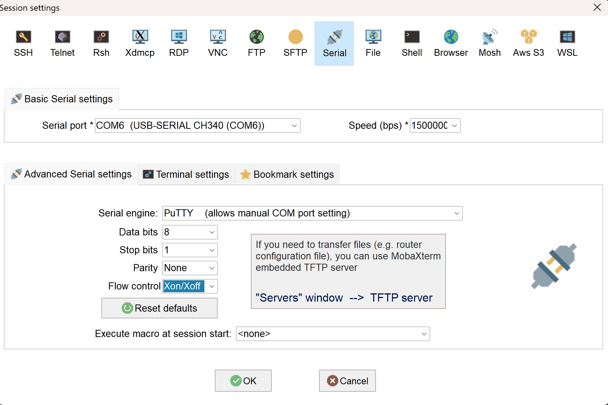
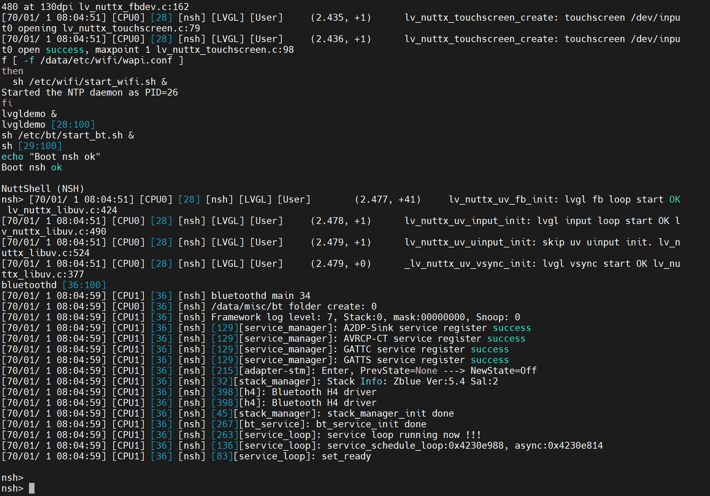

# Connecting to the R528 MIBOX-X1 Board (Serial Port and Network)
\[ English | [简体中文](../../zh-cn/contest_hk_2026/mibox_x1_connect_guide.md) | [繁體中文](../../zh-cn/contest_hk_2026/mibox_x1_connect_guide_zh-hk.md) \]

> This guide explains how, after the firmware is flashed, you connect a Windows computer to the R528 MIBOX-X1 board through the serial port, confirm that the system has started, and connect the board to Wi-Fi. MobaXterm is used as the serial tool. For flashing the firmware, see Section IV of the [Development Board Guide](./mibox_x1_board_guide.md).

## I. Preparation

### 1. Hardware and cabling

- An R528 MIBOX-X1 board with the firmware already flashed.
- One USB Type-A to Type-C cable. Connect one end to the computer and the other end to **port 12 (UART0 debug serial port)** on the board. Port 12 and port 11 (USB-D, used for flashing) are both at the upper right of the board: 12 is on the left and 11 is on the right. Do not swap them. See the [interface diagram](../../zh-cn/contest_hk_2026/images/mibox_x1_interfaces.png) for their positions.
- Set DIP switch **DIP4 to ON**. When DIP4 is OFF, these pins are used for the SD card and nothing appears on the serial port.

### 2. Install the CH340 driver

The board uses a CH340 chip to convert the serial port to USB, so the computer needs the matching driver.

1. Unzip `CH341SER_Windows.zip` from the tool package.
2. Run `SETUP.EXE` as administrator and click "INSTALL".
3. After installation, plug in the serial cable and open Device Manager. Under "Ports (COM & LPT)" you should see `USB-SERIAL CH340 (COMx)`, where `COMx` is the port number (for example COM6). Write it down.

The port number changes with the computer and the USB port. If you do not see this entry, the driver is not installed correctly, or the cable is not plugged into port 12.

## II. Connect the Serial Port with MobaXterm

1. Close every program that might hold this COM port, such as other serial tools. A COM port can be opened by only one program at a time.
2. Open MobaXterm, click **Session** at the upper left, and choose **Serial**.
3. Set the following:

   | Setting | Value |
   | ------- | ----- |
   | Serial port | The COM port you wrote down, for example `COM6 (USB-SERIAL CH340 (COM6))` |
   | Speed (bps) | `1500000` |
   | Data bits | 8 |
   | Stop bits | 1 |
   | Parity | None |
   | Flow control | Xon/Xoff |

   The Speed drop-down list may not contain 1500000. Type it into the box. Data bits, Stop bits, Parity and Flow control are on the **Advanced Serial settings** tab.
4. Click **OK** to open the session.
5. Press the RESET button on the board (SW1, item 13 in the interface diagram). The boot log scrolls in the window. If nothing appears, press Enter once in the window first.

The screenshot below shows the settings we used. The Speed box in the picture cuts off the number; the value entered is `1500000`. The COM port number differs from computer to computer. We used Xon/Xoff for Flow control, and with these settings we saw the complete boot log.



## III. Confirm That the System Has Started

The log ends with `Boot nsh ok`, followed by the NuttShell prompt `nsh>`. The following excerpt comes from a real board. The exact lines, process IDs and times depend on the firmware version:

```text
Started the NTP daemon as PID=26
lvgldemo &
...
echo "Boot nsh ok"
Boot nsh ok

NuttShell (NSH)
nsh>
```

The screenshot below shows the boot log in MobaXterm, from the display driver to `nsh>`:



The log also contains these lines, which tell you whether each part works:

| Log content | Meaning |
| ----------- | ------- |
| Lines from `lv_nuttx_fbdev`, including `480 at 130dpi` | The display driver has started. The screen should show a picture. |
| `touchscreen /dev/input0 opening success` | The touch device is open. Touching the screen should get a reaction. |
| `lvgl fb loop start OK`, `lvgl input loop start OK` | The LVGL UI is running. |
| `bluetoothd` starts, and services such as `A2DP-Sink`, `GATTC` and `GATTS` print `register success` | The Bluetooth stack has started. |

Notes:

- After `nsh>` appears, the LVGL and Bluetooth logs may keep printing and push the prompt up the screen. Press Enter once to get a clean `nsh>`.
- Without a network connection, the system time shows 1970 (`70/01/1` at the start of each log line). This is not a fault.

Once you see `nsh>`, try these two commands:

```text
nsh> help
nsh> uname -a
```

`help` lists the available commands, and `uname -a` shows the kernel information.

## IV. Connect to Wi-Fi

The Wi-Fi module on the board is the RTL8733BS, which supports 2.4 GHz and 5 GHz. The steps below make the board join a router or a phone hotspot as a client (STA). Run the commands at the `nsh>` prompt.

```text
nsh> ifup wlan0
nsh> wapi mode wlan0 2
nsh> wapi psk wlan0 <PSK> 3
nsh> wapi essid wlan0 <SSID> 1
nsh> renew wlan0
```

- Replace `<PSK>` with the Wi-Fi password and `<SSID>` with the Wi-Fi name.
- After `renew wlan0`, the board asks the router for an address.
- Type the commands one at a time. When you paste several lines at once, the serial port sometimes drops characters.

After connecting, check the network with `ping`. You can ping the gateway address of the router, or an address on the Internet:

```text
nsh> ping 8.8.8.8
```

If you get replies, the connection works.

After connecting with the commands above, you have to enter them again each time the board is powered on. The boot script checks for `/data/etc/wifi/wapi.conf` and starts Wi-Fi automatically when the file exists, but we have not verified how to create that file, so please use the manual steps above for now. The 5 GHz band has not been tested on the board either, so use a 2.4 GHz network first. A Wi-Fi password is private. Cover it before you send a screenshot or a log to anyone.

The board can also act as a hotspot (AP mode). See the Wi-Fi part of Section V of the [Development Board Guide](./mibox_x1_board_guide.md) for the commands.

## V. Troubleshooting

| Symptom | Check first |
| ------- | ----------- |
| No CH340 in Device Manager, and no COM port in the MobaXterm list | Whether the CH340 driver is installed; whether the cable is in port 12; try another cable or USB port |
| The port cannot be opened, or access is denied | Another program holds the COM port. Close it first. |
| Output appears but is garbled | Whether Speed is `1500000`, with 8 data bits, 1 stop bit and no parity |
| Nothing appears in the window | Whether DIP4 is ON; whether the cable is in port 12; press Enter once; then press the RESET button |
| Keyboard input has no effect and the output is stuck | Press the RESET button to restart, then look at the log again. You can also try changing Flow control to None. |
| The board does not start after flashing | Whether the flashing cable (port 11) has been unplugged; see Section IV of the [Development Board Guide](./mibox_x1_board_guide.md) |

## VI. Using Other Serial Tools

The serial parameters are the same as above (1500000, 8 data bits, no parity, 1 stop bit), so tools such as PuTTY and picocom also work. Just pick the right COM port or device name. The tool we have actually used and verified on Windows is MobaXterm.
