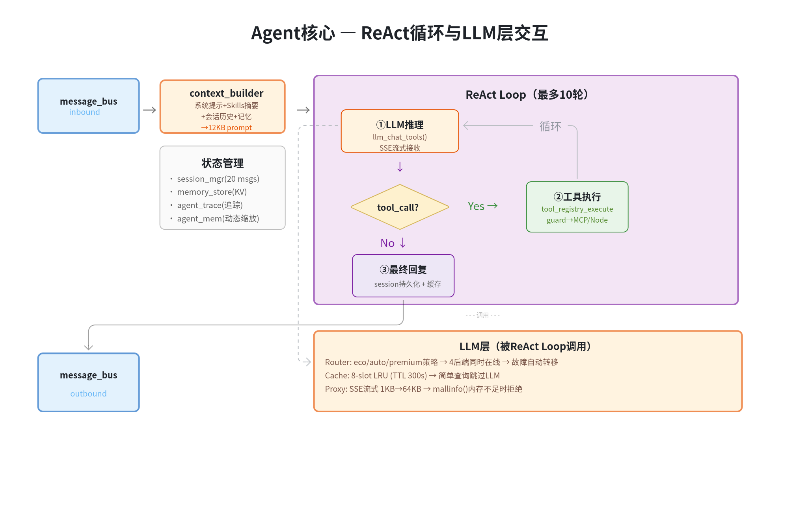
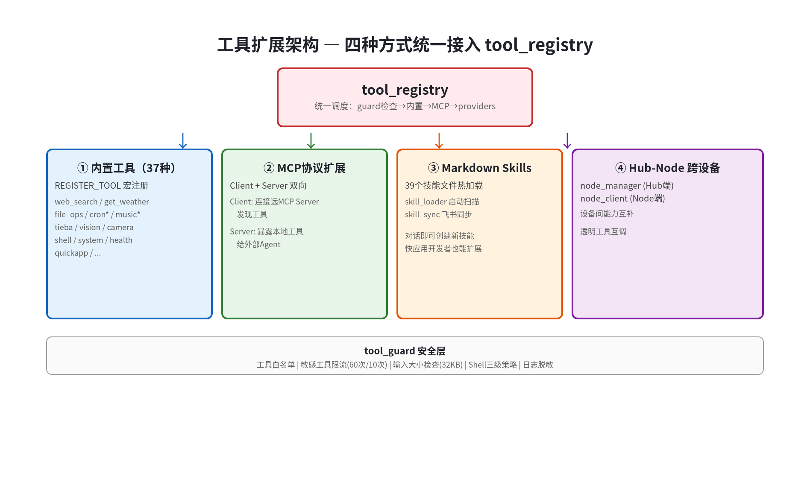
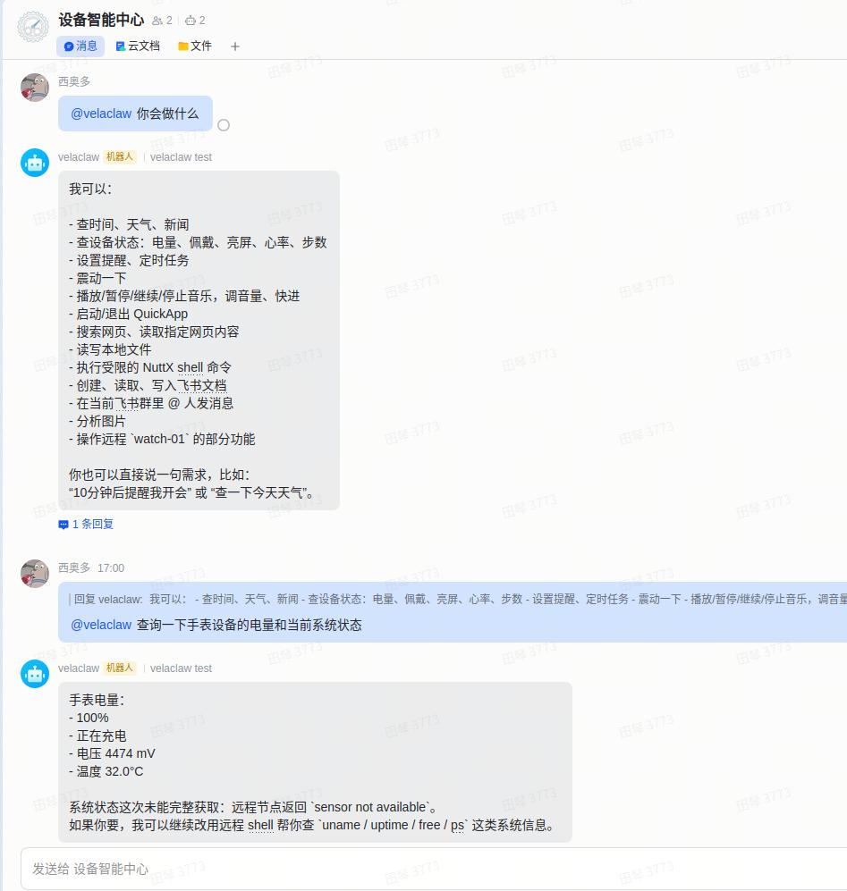
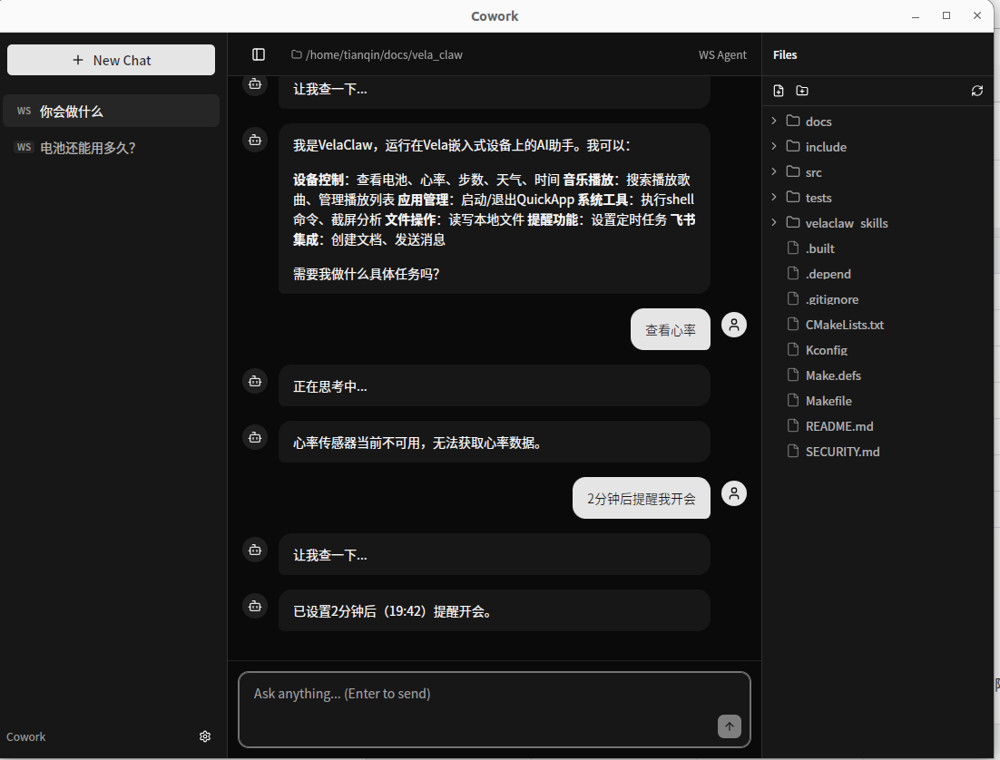

# ai_agent Application Development Quick Start

\[ English | [简体中文](../../../zh-cn/edge_ai_dev/ai_agent/ai_agent_quickstart.md) \]

> This guide shows how to set up an openvela + ai_agent environment from scratch, configure an LLM, try out the core capabilities, and get to know the framework architecture and how it is integrated on development boards.

## I. Prerequisites

### Hardware

- A development board that supports openvela (for boards that already integrate ai_agent, see "VI. Development Board Integration" in this guide)
- A USB data cable (it must be a data cable, not a charge-only one)
- (Optional) An Android phone with [com.agent.coapp](https://github.com/tnaught/com.agent.coapp) installed. It can provision the network and push configuration over Bluetooth, which saves some command-line work

### Environment Setup

Before you start, complete the following:

1. **Set up the openvela development environment**: see [Quick Start (Ubuntu)](../../quickstart/openvela_ubuntu_quick_start.md)
2. **Build the ai_agent firmware**: enable `Application Configuration → Packages → Vela AI Agent` in menuconfig, then build
3. **Flash the development board**: connect the USB cable, flash the firmware, and boot until you see the NSH prompt `nsh>`

> For details on each step, refer to the official openvela documentation. This guide starts at the `nsh>` prompt and assumes your firmware is already running.

### LLM API Key (One Is Enough)

ai_agent needs a large language model to work. You only need an API key for one LLM:

| Service       | Sign-up URL                           | Recommendation |
| ------------- | ------------------------------------- | -------------- |
| Xiaomi MiMo   | https://mimo.mi.com/                  | ⭐ Preferred   |
| DeepSeek      | https://platform.deepseek.com/        | Alternative    |
| Qwen (Tongyi) | https://dashscope.console.aliyun.com/ | Alternative    |
| Kimi          | https://platform.moonshot.cn/         | Alternative    |

> No need to apply right away. Fill in the key after you set up the network in the next section.

## II. Minimal Configuration: Network + LLM API Key = Conversation

> Goal: have your first conversation with ai_agent.
>
> Order matters: **network first, then the LLM**. ai_agent relies on the LLM for reasoning, and the cloud LLM API relies on the network.

### 1. Connect to Wi-Fi

```bash
nsh> ai_agent
```

This opens the ai_agent command line (the prompt changes to `vela>`). Set up the network first:

```bash
vela> set_wifi <wifi_ssid> <wifi_password>
```

Check: `vela> net_test` reports success.

> If your board has no Wi-Fi module (for example the QEMU emulator), you can skip this step. The `goldfish-arm64-v8a-ap` configuration comes with a NAT network (eth0 gets `10.0.2.15` automatically) and is online as soon as it boots. See "VI.3 QEMU Emulator (goldfish-arm64-v8a-ap)" in this guide.

### 2. Set Up the LLM

```bash
# Using MiMo as an example
vela> router_set mimo <api_key>

# Check that the setting took effect
vela> router_status

# Change the model: router_model <router_index> <router_model>
# router_index is the router's index; router_model is the model name (use the name from the model provider's API docs)
vela> router_model 0 mimo-v2.5
```

> You only need to set the key once. It is stored encrypted on the device and survives reboots and reflashing the firmware package. Reflashing the resources or clearing data resets it to empty.

### 3. Your First Conversation

```bash
vela> ask 你好，请介绍一下你自己
```

If everything works, you will see the AI's reply.

### 4. Checkpoint

You get a text reply from the AI → both the network and the LLM are configured correctly.

### 5. No Reply?

Troubleshoot in this order:

```bash
# 1. Make sure the network is up (the most common problem)
vela> net_test

# 2. Make sure the key was saved
vela> config_show

# 3. If the network is down, set up Wi-Fi again
vela> net_status
vela> set_wifi <wifi_ssid> <wifi_password>
```

> At this point ai_agent is usable. The configuration below is added according to your product needs; skipping it does not affect LLM calls.

### 6. Want the AI to Search the Web? → Configure a Search API Key

Once a search API key is configured, ai_agent's built-in `web_search` tool can look things up online. Three search backends are supported, with automatic fallback by priority. Leaving it unconfigured does not affect conversation or other tools.

| Backend               | CLI command            | Sign-up URL          | Notes                                                                                |
| --------------------- | ---------------------- | -------------------- | ------------------------------------------------------------------------------------ |
| Tavily ⭐ Recommended | `set_tavily_key <key>` | https://tavily.com/  | AI-optimized search, POST requests, good TLS compatibility, embedded-device friendly |
| SerpAPI (Google)      | `set_search_key <key>` | https://serpapi.com/ | Google search results, GET requests, may hit routing issues on networks in China     |
| Exa AI                | `set_exa_key <key>`    | https://exa.ai/      | Semantic search engine, suited to knowledge queries                                  |

> There is also `set_news_key <key>` for NewsAPI (news only). Sign up at [NewsAPI](https://newsapi.org/).

**Why Tavily is recommended:**

- POST requests with a JSON body give a more stable TLS handshake and better compatibility on embedded devices
- AI-optimized results return content summaries directly, with no second extraction pass
- SerpAPI depends on Google Search and may have connection problems on networks in China

**Configuration example** (one backend is enough; Tavily is recommended):

```bash
# Recommended: Tavily
vela> set_tavily_key tvly-xxxxxxxxxxxxxxxx

# Alternative: SerpAPI (Google Search)
vela> set_search_key xxxxxxxxxxxxxxxxxxxxxxxxxxxxxxxxxx

# Alternative: Exa AI (semantic search)
vela> set_exa_key exa-xxxxxxxxxxxxxxxx

# News search (optional, configured separately)
vela> set_news_key xxxxxxxxxxxxxxxxxxxxxxxxxxxxxxxxxx
```

**Check:**

```bash
vela> ask 今天北京天气怎么样
vela> ask 搜索一下最新的AI Agent开源项目
```

If the AI returns real-time search results, the search key is configured correctly.

> Checkpoint: the AI's reply contains real-time information (weather, news and so on) instead of just saying "I can't access the internet".
>
> 💡 Like the LLM key, the search key is stored encrypted on the device and survives reboots. Use `config_show` to view the configuration status (keys are masked).
>
> ⚠️ Without a search key, the `web_search` tool is unavailable and the AI can't search the web, but conversation and other tools still work.

## III. Configuring More Features

> Each item is independent and can be combined with the others. Enable the matching Kconfig option in menuconfig first, then rebuild and reflash before using it.

### 1. Want to Chat over WeChat? → Enable the WeChat Channel + Scan to Log In

Enable in menuconfig:

```
Application Configuration → Packages → Vela AI Agent → Enable WeChat channel
```

Kconfig: `AI_AGENT_WEIXIN` (enabled by default). Configure:

```bash
vela> weixin_login
```

The screen shows a QR code. Scan it with WeChat and confirm. After you log in, just send messages to the WeChat bot to chat.

Check: send a message in WeChat and get an AI reply.

### 2. Want to Chat over Feishu? → Enable the Feishu Channel + Configure an App

Enable in menuconfig:

```
Application Configuration → Packages → Vela AI Agent → Enable Feishu bot channel
```

Kconfig: `AI_AGENT_FEISHU` (enabled by default). Configure:

```bash
vela> set_feishu_app <app_id> <app_secret>
```

You need to create an app on the Feishu Open Platform to get the App ID and App Secret.

Check: @mention the bot in a Feishu group and get a reply.

### 3. Want Voice Interaction? → Enable Audio + Volcengine

Get the APIKey, AppID and Token from the [Volcengine Speech Service console](https://console.volcengine.com/speech/service/10038), then enter them:

```bash
vela> set_volc_key <api_key>
vela> set_volc_asr <app_id> <access_token> volcengine_streaming_common
vela> voice_start
```

Then just talk into the microphone.

Check: after you speak, you get a voice + text reply.

### 4. Short on Memory? → Turn Off Modules You Don't Need

Turn modules off as needed in menuconfig under `Application Configuration → Packages → Vela AI Agent`:

| Module                     | Kconfig             | Default | Footprint      | When to turn off                                                                             |
| -------------------------- | ------------------- | ------- | -------------- | -------------------------------------------------------------------------------------------- |
| Feishu bot                 | `AI_AGENT_FEISHU`   | On      | ~108KB         | Off if you don't use Feishu                                                                  |
| WeChat bot                 | `AI_AGENT_WEIXIN`   | On      | ~45KB          | Off if you don't use WeChat                                                                  |
| MQTT                       | `AI_AGENT_MQTT`     | On      | ~15KB          | Off if you don't do IoT                                                                      |
| Multi-device collaboration | `AI_AGENT_NODE`     | On      | ~20KB          | Off if you don't use Hub/Node                                                                |
| MCP protocol               | `AI_AGENT_MCP`      | On      | ~10KB          | Off if you don't use remote tools                                                            |
| LVGL UI                    | `AI_AGENT_LVGL_UI`  | Off     | ~50KB          | On only if you need on-screen chat                                                           |
| BLE GATT                   | `AI_AGENT_BLE_GATT` | Off     | —              | On if you need a BLE data channel (iOS/Android clients)                                      |
| BLE network channel        | `AI_AGENT_BLE_NET`  | Off     | —              | On if there is no Wi-Fi and the device goes online through a phone app's Bluetooth SPP proxy |
| Camera                     | `AI_AGENT_CAMERA`   | Off     | Requires VIDEO | On for visual recognition scenarios                                                          |

Minimal configuration (CLI only): turning off Feishu + WeChat + MQTT + Node + MCP + LVGL_UI saves about 260KB of memory.

## IV. Trying the Core Capabilities

> You're up and running. Now see how ai_agent differs from an ordinary chatbot.

### 1. Tool Calls

ai_agent doesn't just chat. It can **operate the device**:

```bash
# Check the system status
vela> ask 现在系统内存用了多少？

# Play music
vela> ask 播放音乐

# Set a scheduled reminder
vela> ask 提醒我明早7点开会
```

Built-in tools at a glance:

| Category | Tools                      | What they do                |
| -------- | -------------------------- | --------------------------- |
| Search   | web_search                 | Search the web              |
| Files    | read_file, write_file      | Read and write files        |
| Schedule | cron_add, cron_list        | Add or list scheduled tasks |
| Vision   | analyze_image              | Analyze images              |
| Device   | get_battery, get_heartrate | Get device status           |
| Feishu   | feishu_doc_create          | Create Feishu documents     |
| Music    | music_play, music_search   | Play or search music        |

### 2. The Skills System

Skills tell ai_agent "how to do it" in a specific scenario. The difference from tools: a tool "can do something", a skill "knows how to do it".

Built-in skills: weather, daily-briefing, reminder, translate, news-digest.

```bash
vela> ask 每天早上8点给我发天气简报
```

ai_agent automatically combines weather + reminder + cron_add to complete the task.

### 3. Proactive Tasks

This is the core capability that sets ai_agent apart from an ordinary chatbot: **it acts on its own without waiting for you to ask**.

```bash
# After you set a scheduled reminder, it pushes the reminder when the time comes
vela> ask 提醒我每天下午3点喝水
```

You don't have to ask "what reminders do I have". It comes to you on time.

### 4. MCP Remote Tools

MCP (Model Context Protocol) lets you call tools on remote servers:

```bash
# Add the Amap (Gaode Maps) MCP server
vela> mcp_add amap https://mcp.amap.com/mcp?key=<api_key>

# List the discovered tools
vela> mcp_discover
```

## V. Architecture and Design

> You've used it now. Before you start developing a specific Agent application, take a few minutes to understand how ai_agent works and how it is designed.

### 1. The Core of the Agent



### 2. How Tools Are Extended



### 3. Example Scenarios

**Controlling smart devices through Feishu:**



**Working together with a desktop agent:**



When developing an application, you mainly deal with these three layers:

1. **openvela + LVGL**: provides display, input and the event loop. Your application runs on top of it
2. **The ai_agent framework**: provides the Router, Tools, proactive tasks and Skills. Your application calls these capabilities
3. **Access channels**: users interact with your application through WeChat, Feishu or voice

**How it differs from an ordinary embedded application**: an ordinary application works as "user taps a button → code runs"; an Agent application works as "user speaks → AI understands → picks a tool → runs it → may also push proactively".

## VI. Development Board Integration

ai_agent provides preset defconfig files so that different development boards can integrate it quickly. Each board's defconfig directory (`packages/ai_agent/defconfigs/<board>/`) contains a README with the details.

### 1. ESP32-S3-EYE

| Item      | Description                                    |
| --------- | ---------------------------------------------- |
| Chip      | ESP32-S3 (Xtensa dual-core)                    |
| Display   | ST7789 240×240 LCD                             |
| Memory    | 8MB PSRAM                                      |
| Features  | Wi-Fi, LCD, no BLE                             |
| defconfig | `defconfigs/esp32s3-eye/esp32s3-eye_defconfig` |

```bash
# 1. Copy the defconfig into the board's configuration directory
cp packages/ai_agent/defconfigs/esp32s3-eye/esp32s3-eye_defconfig \
   nuttx/boards/xtensa/esp32s3/esp32s3-eye/configs/ai_agent/defconfig

# 2. Load the ESP-IDF environment
source /path/to/esp-idf/export.sh
export CCACHE_DISABLE=1

# 3. Clean + build (the fix script must run in the background during the build)
./build.sh esp32s3-eye:ai_agent distclean
bash packages/ai_agent/fix_esp32s3.sh &
./build.sh esp32s3-eye:ai_agent

# 4. Flash
esptool.py -c esp32s3 -p /dev/ttyACM0 -b 460800 \
  --before default_reset --after hard_reset \
  write_flash 0x0 nuttx/nuttx.bin
```

> `fix_esp32s3.sh` fixes upstream compatibility issues such as the mbedtls header conflict between ESP-IDF and NuttX, CCM cipher suite compatibility and spinlock initialization (these can't be expressed in a defconfig and must be patched with a script).
> 
> Known warnings you can ignore: `ccache: error: execute_noreturn` and `expr: syntax error`. Setting `export CCACHE_DISABLE=1` removes them.

### 2. Gemini-S1 (Allwinner R528)

| Item      | Description                                   |
| --------- | --------------------------------------------- |
| Chip      | R528S3 (ARM Cortex-A7)                        |
| Display   | ILI9341 LCD                                   |
| Features  | Wi-Fi, BLE GATT, media server, mini_memo demo |
| defconfig | `defconfigs/gemini-s1/gemini-s1_defconfig`    |

Key Kconfig options:

```
CONFIG_EXAMPLES_AI_AGENT_VELA=y   # Enable ai_agent
CONFIG_LVX_USE_DEMO_MINI_MEMO=y   # Enable the mini_memo LVGL demo
CONFIG_AI_AGENT_BLE_GATT=y        # BLE GATT data channel
CONFIG_MEDIA=y                    # media framework
CONFIG_MEDIA_SERVER=y             # media server (recording + playback)
CONFIG_LIB_FFMPEG=y               # PCM/WAV pipeline
```

```bash
# 1. Copy the defconfig
cp packages/ai_agent/defconfigs/gemini-s1/gemini-s1_defconfig \
   vendor/allwinnertech/boards/r528/r528s3-gemini-s1/configs/nsh_minidisplay/defconfig

# 2. Apply the audio framework patch
bash packages/ai_agent/fix_gemini_s1.sh

# 3. Build
./build.sh vendor/allwinnertech/boards/r528/r528s3-gemini-s1/configs/nsh_minidisplay/ \
    -e -Wno-error -j"$(nproc)"
```

> `fix_gemini_s1.sh` does two things:
> 
> (1) It replaces the vendor's full-featured smart-speaker pipeline with a minimal audio graph (keeping only the recording and playback paths);
> 
> (2) It applies the PTT recording fix patches (DMA interrupt use-after-free, non-blocking handling in the media server, abufsink sample-rate negotiation and so on).
> 
> Running mini_memo: after ai_agent starts, find the mini_memo entry in the on-screen launcher, hold the PTT button to record, and release it to have the note classified and stored automatically.

### 3. QEMU Emulator (goldfish-arm64-v8a-ap)

| Item      | Description                                                        |
| --------- | ------------------------------------------------------------------ |
| Platform  | QEMU ARM64 emulator                                                |
| Features  | Quick app ↔ ai_agent linkage (`system.velaclaw`), ADB debugging    |
| defconfig | `defconfigs/goldfish-arm64-v8a-ap/goldfish-arm64-v8a-ap_defconfig` |

This configuration verifies three capabilities together: installing and running a quick app, enabling ai_agent, and a quick app calling ai_agent through `system.velaclaw`.

**Integration steps:**

```bash
# 1. Copy the defconfig
cp packages/ai_agent/defconfigs/goldfish-arm64-v8a-ap/goldfish-arm64-v8a-ap_defconfig \
   vendor/openvela/boards/vela/configs/goldfish-arm64-v8a-ap/defconfig

# 2. Clean + build (a clean build is required after changing the defconfig)
rm -rf cmake_out/vela_goldfish-arm64-v8a-ap
./build.sh vendor/openvela/boards/vela/configs/goldfish-arm64-v8a-ap --cmake -j8

# 3. Start the emulator
./emulator.sh cmake_out/vela_goldfish-arm64-v8a-ap/
```

**Install the demo quick app:**

```bash
# Extract the quick app and push it to the emulator
adb connect 127.0.0.1:5555
mkdir -p /tmp/agent && \
  unzip -o packages/ai_agent/defconfigs/goldfish-arm64-v8a-ap/com.application.agent.demo.debug.1.0.0.rpk \
  -d /tmp/agent
adb shell mkdir -p /data/app/com.application.agent.demo
adb push /tmp/agent/. /data/app/com.application.agent.demo/

# Push the fonts
adb push vendor/openvela/boards/vela/resource/font /data/
```

**Calling ai_agent from a quick app:**

```javascript
import velaclaw from '@system.velaclaw'

velaclaw.ask({
  query: '北京今天天气怎么样',
  success: function (res) { console.log('AI reply:', res.reply) },
  fail:    function (data, code) { console.log('fail, code:', code) }
})
```

> 💡 The QEMU emulator has a NAT network by default (eth0 gets `10.0.2.15` automatically), so no Wi-Fi provisioning is needed.

**Notes:**

- `router_set`, `ask` and similar are commands at the `vela>` prompt, not NSH commands. Run `ai_agent` in the foreground to enter the vela CLI, or push a config file in advance.
- For the complete flow of a quick app calling `@system.velaclaw` on this emulator, see [Calling the On-Device AI Agent from a Quick App](../../app_dev/quickapp/quickapp_velaclaw.md).

### 4. Adding a New Development Board

If your board isn't in the list above, create a configuration based on an existing defconfig:

1. Create `<device-name>_defconfig` under `defconfigs/<device-name>/`
2. If extra patches are needed (things that can't be expressed in Kconfig), create a `fix_<device>.sh` script
3. Add a `README.md` that describes the configuration and the patches
4. Submit a PR to the `packages_ai_agent` repository

## VII. FAQ

### 1. defconfig Loop

- **Symptom**: you changed the defconfig, but after the build the configuration was overwritten again.
- **Cause**: openvela uses a CMake cache, so editing the defconfig directly has no effect.
- **Solution**: change it through menuconfig, or clear the build cache and reconfigure:

```bash
rm -rf cmake_out/
./build.sh <board_config> --cmake menuconfig
```

### 2. Link Misalignment After a NuttX Upgrade

- **Symptom**: after you upgrade the openvela branch, the link stage reports alignment errors.
- **Cause**: the new NuttX version changed the alignment requirements of some structures, and the old build artifacts weren't updated with it.
- **Solution**: do a full clean and rebuild:

```bash
rm -rf cmake_out/
./build.sh <board_config> --cmake -j8
```

If that still doesn't help, check whether a patch needs to be applied.

### 3. Audio Framework Crash

- **Symptom**: a crash when calling audio APIs, especially in the encode/decode stage.
- **Cause**: the way audio framework APIs are called changed in the new version, and the old usage is incompatible.
- **Solution**: make sure you use the audio APIs from the latest branch, and if needed check the audio-related source code in packages_ai_agent.

### 4. Crash When Creating LVGL Widgets

- **Symptom**: a crash when creating LVGL widgets from another thread.
- **Cause**: LVGL isn't thread-safe, so widgets can't be created outside the LVGL thread.
- **Solution**: use `lv_async_call()` for a thread-safe call:

```c
/* ❌ Wrong: creating a widget directly outside the LVGL thread */
void other_thread(void) {
    lv_obj_t* btn = lv_button_create(screen);
}

/* ✅ Right: hand it over to the LVGL thread with async_call */
void create_btn_async(void* arg) {
    lv_obj_t* btn = lv_button_create(screen);
}
void other_thread(void) {
    lv_async_call(create_btn_async, NULL);
}
```

### 5. Shell Command Execution Rejected

- **Symptom**: ai_agent's call to the run_shell tool is rejected.
- **Cause**: run_shell defaults to "allowlist mode", which only permits predefined safe commands.
- **Solution**: in a development environment you can switch to Full mode: `Security → Shell security policy → Full mode (development)`.

> Don't use Full mode in production.

### 6. Out of Memory During the Build (OOM)

- **Symptom**: `cc1plus: out of memory` during the build.
- **Solution**: reduce the number of parallel build jobs:

```bash
./build.sh <board_config> --cmake -j2
```

### 7. Missing Dependencies

- **Symptom**: errors such as `cmake: command not found`.
- **Solution**:

```bash
sudo apt install cmake ninja-build gcc g++ python3
```

## VIII. Going Further

### 1. Bluetooth Provisioning and Chat Through the Phone App (com.agent.coapp)

If you have an Android phone, you can install [com.agent.coapp](https://github.com/tnaught/com.agent.coapp) and do **Wi-Fi provisioning** after connecting to the device over Bluetooth. If the phone and the smart device are on the same LAN, you can also **configure the various keys**, **push and delete skills**, **get ai_agent run logs in real time**, and **chat between the phone and the device**. This saves command-line work and is more flexible.

Workflow:

1. Install com.agent.coapp on the phone
2. Turn on Bluetooth, then scan for and connect to the device
3. Enter the Wi-Fi and LLM key in the app and push them with one tap

This suits users who don't want to type configuration in NSH by hand, and it also opens up more cross-device collaboration capabilities.

### 2. More Demos

| Demo      | Description                                                              | Code location                                                                      |
| --------- | ------------------------------------------------------------------------ | ---------------------------------------------------------------------------------- |
| ai_chat   | AI chat assistant showing basic conversation and TTS                     | `packages/demos/ai_chat/`                                                          |
| mini-memo | AI memory assistant showing proactive tasks + Router + structured output | Build it step by step with the [mini-memo application guide](./mini_memo_guide.md) |

### 3. Full Documentation

- [ai_agent repository](../../../../../../packages_ai_agent): source code and more documentation
- [openvela main repository](../../../../../../): system source code
