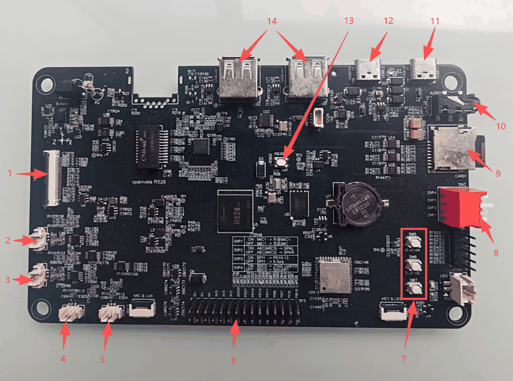
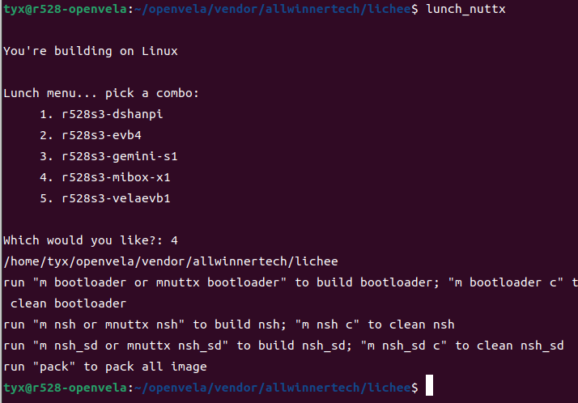
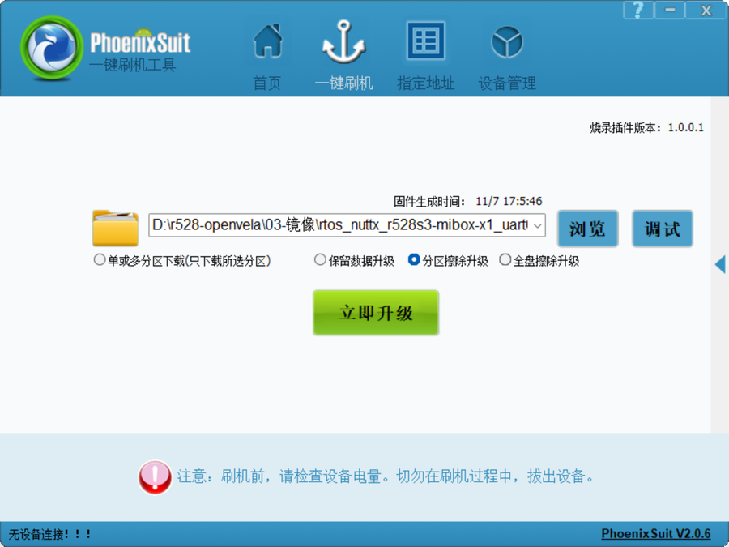

# R528 MIBOX-X1 开发板使用指南
\[ [English](../../en/contest_hk_2026/mibox_x1_board_guide.md) | 简体中文 | [繁體中文](./mibox_x1_board_guide_zh-hk.md) \]

> 本文介绍 R528 MIBOX-X1 开发板（全志 R528-S3）在 openvela 上的使用：硬件规格、接口与拨码开关、编译、烧录、外设测试和第一个应用。
>
> 板级代码在 [`vendor_allwinnertech/boards/r528/r528s3-mibox-x1`](https://github.com/open-vela/vendor_allwinnertech/tree/dev-ai-contest-2026/boards/r528/r528s3-mibox-x1)，目录说明见该目录下的 [README_zh-cn.md](https://github.com/open-vela/vendor_allwinnertech/blob/dev-ai-contest-2026/boards/r528/r528s3-mibox-x1/README_zh-cn.md)。

## 一、硬件规格

| 项目     | 规格                                                                      |
| -------- | ------------------------------------------------------------------------- |
| 主控     | 全志 R528-S3，双核 Arm Cortex-A7，主频 1.2GHz                             |
| 内存     | 128MB DDR3                                                                |
| 存储     | 256MB SPI NAND（W25N02KVZEIR），TF 卡槽                                   |
| 显示     | 480×480 MIPI DSI 屏（ST7701S）                                            |
| 触摸     | GT911 电容触摸（I2C）                                                     |
| 音频     | NS4150B 功放 + 左右喇叭，两路麦克风输入（MIC1、MIC2），3.5mm 耳机口       |
| 无线     | Wi-Fi（SDIO）+ 蓝牙（UART）                                               |
| 传感器   | ICM20948 九轴传感器（SPI）                                                |
| 其他     | 红外收发，3 个 LRADC 按键，PWM 调光 LED，RTC（32.768kHz 晶振 + 纽扣电池） |
| 扩展     | 排针引出 UART、I2C、SPI、PWM、ADC、GPIO                                   |
| 调试串口 | 板载 USB 转串口（CH340），1500000、8、N、1                                |

## 二、接口与拨码开关



| 序号 | 接口 / 器件           | 说明                                        |
| ---- | --------------------- | ------------------------------------------- |
| 1    | 触摸屏 FPC 接口       | 连接 MIPI DSI 显示屏与 GT911 电容触摸屏     |
| 2    | 喇叭（右声道）        | 右声道扬声器输出                            |
| 3    | 喇叭（左声道）        | 左声道扬声器输出                            |
| 4    | MIC2                  | 第二路麦克风输入                            |
| 5    | MIC1                  | 第一路麦克风输入，可切换外接 MIC 或耳机 MIC |
| 6    | 外部排针              | 引出 GPIO、ADC、UART、I2C、SPI              |
| 7    | 按键（3 个）          | LRADC 按键                                  |
| 8    | 拨码开关              | 4 位，功能见下表                            |
| 9    | SD 卡槽               | TF 卡，识别为 `/dev/mmcsd1`                 |
| 10   | 耳机接口              | 3.5mm 耳机输出                              |
| 11   | USB 固件烧写 / adb 口 | USB-D 口，用于固件烧写与 adb 调试           |
| 12   | 调试串口              | 板载 USB 转串口（UART0），1500000、8、N、1  |
| 13   | 复位按键              | RESET（SW1）                                |
| 14   | USB-A 接口（2 个）    | 板上丝印为 USB-H1、USB-H2，本文不涉及       |

拨码开关 SW3，下表按板上丝印整理，以实物为准：

| 拨码位 | ON                                    | OFF                      |
| ------ | ------------------------------------- | ------------------------ |
| DIP1   | MIC1 接外接 MIC1                      | MIC1 接耳机 MIC          |
| DIP2   | 回采数据取左声道（SPKL）              | 回采数据取右声道（SPKR） |
| DIP3   | SPI1 接外部排针（PD10 到 PD13）       | SPI1 接板载九轴传感器    |
| DIP4   | 引脚用作 UART0 调试串口（JTAG UART0） | 引脚用作 SD 卡           |

DIP3 和 DIP4 是二选一：外部排针 SPI 与九轴传感器不能同时使用，UART0 调试串口与 SD 卡不能同时使用。

## 三、获取代码并编译

编译需要 Ubuntu 22.04，依赖包、`repo` 和 `git-lfs` 的安装见[快速入门（Ubuntu）](../quickstart/openvela_ubuntu_quick_start.md)。

### 1、获取代码

```bash
mkdir openvela && cd openvela
repo init -u https://github.com/open-vela/manifests.git -b dev-ai-contest-2026 -m openvela.xml --repo-url=https://mirrors.tuna.tsinghua.edu.cn/git/git-repo/ --git-lfs
repo sync -c -j4
```

`vendor/allwinnertech` 已包含在代码仓库中，不需要另外下载。

### 2、编译和打包

```bash
cd vendor/allwinnertech/lichee
source envsetup.sh
lunch_nuttx          # 选择 r528s3-mibox-x1
m nsh                # 编译；清理用 m nsh c
pack                 # 打包
```

`lunch_nuttx` 会列出所有 R528 板级包，选择 `r528s3-mibox-x1`。下图中它排在第 4 位，新板卡加入后编号可能变化，以屏幕上的列表为准。



打包完成后，固件在：

```text
vendor/allwinnertech/lichee/out/r528s3/mibox-x1_nand/rtos_nuttx_r528s3-mibox-x1_uart0_256Mnand.img
```

### 3、两个配置

| 配置          | 控制台                   | SD 卡  | 编译命令   |
| ------------- | ------------------------ | ------ | ---------- |
| `nsh`（默认） | UART0（板载 USB 串口）   | 不启用 | `m nsh`    |
| `nsh_sd`      | UART2（引脚 PC00、PC01） | 启用   | `m nsh_sd` |

SD 卡与 UART0 调试口共用 PF2、PF4 两个引脚，所以用 `nsh_sd` 时板载 USB 串口不能用，要在 UART2 的引脚上另接 USB 转串口线，同时把拨码开关 DIP4 拨到 OFF。

修改配置（menuconfig）在 SDK 根目录执行：

```bash
./build.sh vendor/allwinnertech/boards/r528/r528s3-mibox-x1/configs/nsh menuconfig
```

## 四、固件烧录

烧录在 Windows 电脑上进行，需要三样工具：

- PhoenixSuit：全志的烧录工具，解压即可使用。
- 全志 USB 烧录驱动：解压后双击安装程序，按提示安装到完成。
- CH340 驱动：板载 USB 转串口芯片的驱动，用来看调试串口。

工具包随开发板资料提供。安装驱动需要管理员权限。

### 1、连接

用 USB Type-A 转 Type-C 线，把电脑连到开发板的 USB-D 口（接口图中的 11 号）。要看调试串口，再用一根线连到 12 号接口。

### 2、烧录步骤

1. 打开 PhoenixSuit，点击「浏览」选择上一节打包出的 `.img` 固件。下图中选的是「分区擦除升级」。

   

2. 短按开发板上的 SW1（RESET）键。
3. 弹出对话框，选择「是」，开始烧写。
4. 烧写完成后，拔掉烧写线再重新上电。插着烧写线时系统可能无法启动。

### 3、查看串口

串口参数是 1500000、8 位数据位、无校验、1 位停止位。Windows 上可以用 MobaXterm、PuTTY，Ubuntu 上可以用 `picocom`。启动后看到 `nsh>` 提示符就说明系统已经运行。

## 五、外设测试

以下命令都在 `nsh>` 提示符下执行，使用默认的 `nsh` 配置。

### 1、UART

把对应串口的 TX、RX 短接做回环测试：

```text
nsh> echo 123456789 > /dev/uart2
nsh> cat /dev/uart2
nsh> echo 123456789 > /dev/uart4
nsh> cat /dev/uart4
```

### 2、I2C

```text
nsh> i2c dev -b 0 0 7f
nsh> i2c dev -b 2 0 7f
```

I2C2 上挂的是触摸芯片 GT911，扫描结果里应该能看到它的地址。

### 3、GPIO

```text
nsh> echo 1 > /dev/gpio0
nsh> echo 0 > /dev/gpio0
```

`/dev/gpio1`、`/dev/gpio2`、`/dev/gpio3` 的用法相同。

### 4、LED

```text
nsh> pwm -p /dev/pwm1 -d 50
```

`-d` 是占空比，50 表示亮度 50%。

### 5、按键（LRADC）

```text
nsh> buttons
```

按下板上的 3 个按键，终端会打印按键事件。

### 6、ADC（GPADC）

```text
nsh> adc -p /dev/adc0
nsh> adc -p /dev/adc1
```

### 7、音频

录音：

```text
nsh> amixer set 17 1      #'ADC1_2 digital volume switch'
nsh> amixer set 22 1      #'MIC1 input select'
nsh> amixer set 25 1      #'MIC1 input switch'
nsh> amixer set 8 20      #'MIC1 gain volume'
nsh> amixer set 19 160    #'ADC1 digital volume'
nsh> amixer set 23 1      #'MIC2 input select'
nsh> amixer set 28 1      #'MIC2 input switch'
nsh> amixer set 9 20      #'MIC2 gain volume'
nsh> amixer set 20 160    #'ADC2 digital volume'
nsh> arecord -D hw:audiocodec -r 16000 -c 2 -d 5 /data/record.wav
```

播放：

```text
nsh> aplay -D hw:audiocodec /data/startup.wav
```

### 8、红外

需要两块开发板，一块发送，一块接收，运行测试程序：

```text
nsh> factory_test -c 15     # 发送
nsh> factory_test -c 16     # 接收
```

### 9、SD 卡

需要使用 `nsh_sd` 配置，并把 DIP4 拨到 OFF（见第三节第 3 点）。插入 TF 卡后，设备名是 `/dev/mmcsd1`，自动挂载到 `/sdcard`。

### 10、Wi-Fi

AP 模式：

```text
nsh> wapi disconnect wlan0
nsh> ifup wlan0
nsh> wapi mode wlan0 3
nsh> wapi psk wlan0 <PSK> 3        # <PSK> 改为要设定的密码，如 123456
nsh> wapi essid wlan0 <SSID> 1     # <SSID> 改为要设定的名称，如 R528
nsh> dhcpd wlan0 &
```

然后用电脑的 Wi-Fi 连接这个名称。

STA 模式：

```text
nsh> wapi disconnect wlan0
nsh> ifup wlan0
nsh> wapi mode wlan0 2
nsh> wapi psk wlan0 <PSK> 3        # <PSK> 改为路由器或手机热点的密码
nsh> wapi essid wlan0 <SSID> 1     # <SSID> 改为路由器或手机热点的名称
nsh> renew wlan0
nsh> ping xxx.xxx.xxx.xxx
```

### 11、蓝牙

开发板连手机（手机作 server）：

```text
nsh> bttool
nsh> enable
nsh> scan start
# 扫描到手机蓝牙后
nsh> scan stop
nsh> leconnect -a xx:xx:xx:xx:xx:xx -t 1     # connection state: 3 表示连接成功
```

手机连开发板（开发板作 server）：

```text
nsh> bttool
nsh> enable
nsh> adv start -D
```

然后在手机上用 nRF Connect 扫描并连接。

### 12、SPI 与九轴传感器

九轴传感器接在 SPI1 上，先确认 DIP3 在 OFF。读取芯片 ID，返回 `0xEA` 说明正常：

```text
nsh> spi exch -b 1 -f 3000000 -m 3 -n 0 -w 8 -x 2 80 00
```

读取加速度、陀螺仪、磁力计数据：

```text
nsh> uorb_listener -n 20 -r 25 sensor_accel1
nsh> uorb_listener -n 20 -r 25 sensor_gyro1
nsh> uorb_listener -n 20 -r 25 sensor_mag1
```

板子静止放平时，加速度的 z 轴约为 1g。

### 13、RTC

```text
nsh> date -s "Jan 01 12:34:56 2026"     # 设置时间
nsh> date                               # 读取时间
```

## 六、开发第一个应用 hello_r528

应用放在 `vendor/allwinnertech/apps/` 下，需要这五个文件：

```text
vendor/allwinnertech/apps/hello_r528/
├── hello_r528_main.c    # 应用的主要逻辑
├── Kconfig              # 条件编译宏，用于功能裁剪
├── CMakeLists.txt       # CMake 构建系统使用
├── Make.defs            # 把应用目录加入编译，必须被上层目录包含
└── Makefile             # 库内部文件的编译规则和编译标志
```

`hello_r528_main.c`：

```c
#include <stdio.h>

int main(int argc, FAR char *argv[])
{
    printf("Hello, R528!!!\n");
    return 0;
}
```

`Kconfig`：

```kconfig
config HELLO_R528
    tristate "\"Hello, R528!\" example"
    default n
    ---help---
        Enable the \"Hello, R528!\" example

if HELLO_R528

config HELLO_R528_PROGNAME
    string "Program name"
    default "hello_r528"
    ---help---
        This is the name of the program that will be used when the NSH ELF
        program is installed.

config HELLO_R528_PRIORITY
    int "Hello R528 task priority"
    default 100

config HELLO_R528_STACKSIZE
    int "Hello R528 stack size"
    default DEFAULT_TASK_STACKSIZE

endif
```

`CMakeLists.txt`：

```cmake
if(CONFIG_HELLO_R528)
  nuttx_add_application(
    MODULE ${CONFIG_HELLO_R528}
    NAME ${CONFIG_HELLO_R528_PROGNAME}
    SRCS hello_r528_main.c
    STACKSIZE ${CONFIG_HELLO_R528_STACKSIZE}
    PRIORITY ${CONFIG_HELLO_R528_PRIORITY})
endif()
```

`SRCS` 里 main 所在的文件必须排第一个。

`Makefile`：

```makefile
include $(APPDIR)/Make.defs

PROGNAME  = $(CONFIG_HELLO_R528_PROGNAME)
PRIORITY  = $(CONFIG_HELLO_R528_PRIORITY)
STACKSIZE = $(CONFIG_HELLO_R528_STACKSIZE)
MODULE    = $(CONFIG_HELLO_R528)

MAINSRC = hello_r528_main.c

include $(APPDIR)/Application.mk
```

`PROGNAME`、`PRIORITY`、`STACKSIZE` 是添加一个应用必须定义的三个参数，`PROGNAME` 就是在 `nsh>` 下输入的命令名。

`Make.defs`：

```makefile
ifneq ($(CONFIG_HELLO_R528),)
CONFIGURED_APPS += $(APPDIR)/vendor/allwinnertech/apps/hello_r528
endif
```

### 验证

1. 新增应用后先清理，让构建系统重新扫描 Kconfig：`m nsh c`。
2. 在 SDK 根目录执行 menuconfig，启用路径是 Application Configuration → Allwinnertech Apps → "Hello, R528!" example：

   ```bash
   ./build.sh vendor/allwinnertech/boards/r528/r528s3-mibox-x1/configs/nsh menuconfig
   ```

3. 回到 `vendor/allwinnertech/lichee`，依次执行 `m nsh` 和 `pack`。
4. 按第四节烧录。
5. 在串口里输入 `hello_r528`，看到 `Hello, R528!!!` 就成功了。
