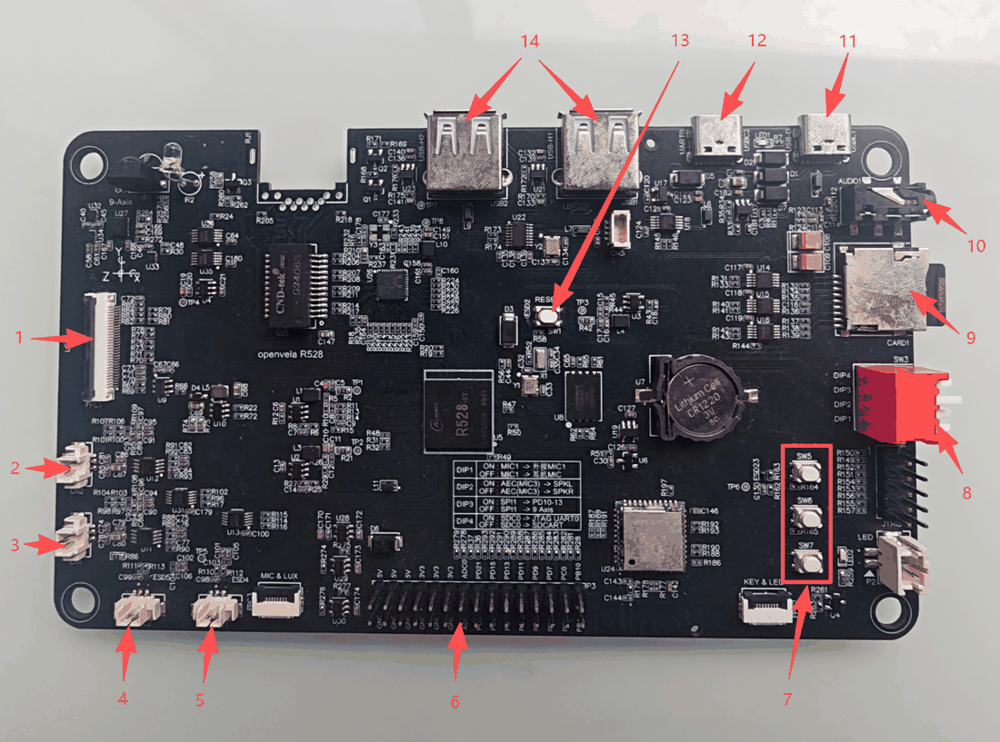
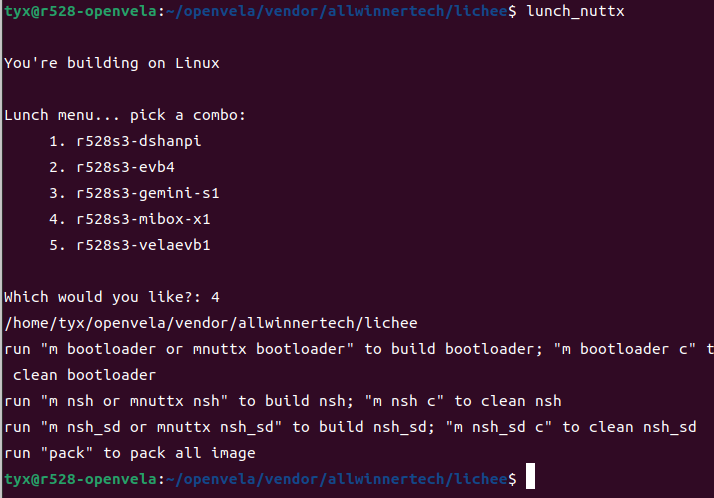
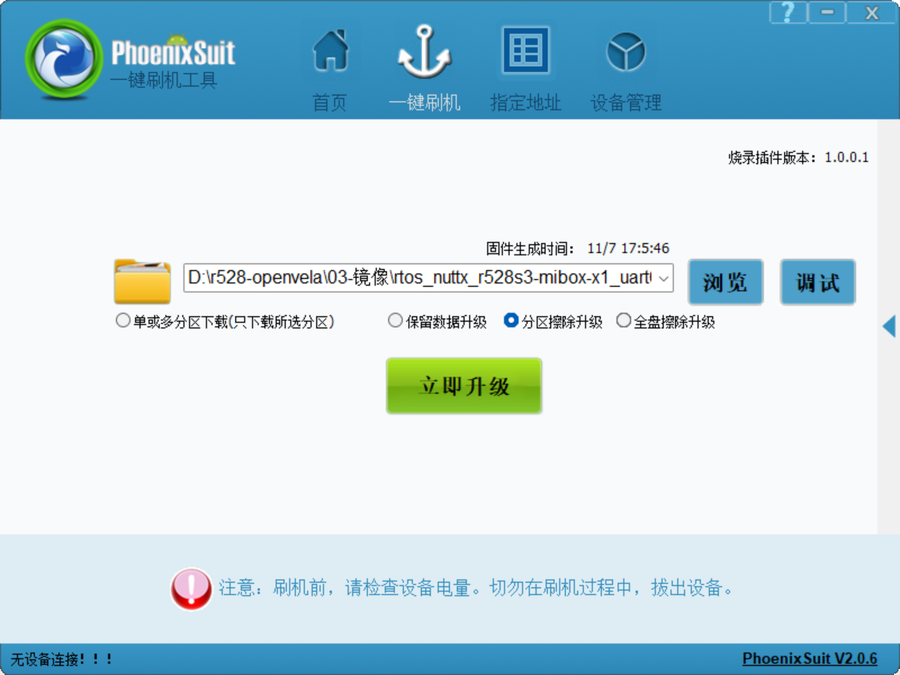

# R528 MIBOX-X1 開發板使用指南
\[ [English](../../en/contest_hk_2026/mibox_x1_board_guide.md) | [简体中文](./mibox_x1_board_guide.md) | 繁體中文 \]

> 本文介紹 R528 MIBOX-X1 開發板（全志 R528-S3）在 openvela 上的使用：硬件規格、接口與撥碼開關、編譯、燒錄、外設測試和第一個應用。
>
> 板級代碼在 [`vendor_allwinnertech/boards/r528/r528s3-mibox-x1`](https://github.com/open-vela/vendor_allwinnertech/tree/dev-ai-contest-2026/boards/r528/r528s3-mibox-x1)，目錄説明見該目錄下的 [README_zh-cn.md](https://github.com/open-vela/vendor_allwinnertech/blob/dev-ai-contest-2026/boards/r528/r528s3-mibox-x1/README_zh-cn.md)。

## 一、硬件規格

| 項目     | 規格                                                                      |
| -------- | ------------------------------------------------------------------------- |
| 主控     | 全志 R528-S3，雙核 Arm Cortex-A7，主頻 1.2GHz                             |
| 內存     | 128MB DDR3                                                                |
| 存儲     | 256MB SPI NAND（W25N02KVZEIR），TF 卡槽                                   |
| 顯示     | 480×480 MIPI DSI 屏（ST7701S）                                            |
| 觸摸     | GT911 電容觸摸（I2C）                                                     |
| 音頻     | NS4150B 功放 + 左右喇叭，兩路麥克風輸入（MIC1、MIC2），3.5mm 耳機口       |
| 無線     | Wi-Fi（SDIO）+ 藍牙（UART）                                               |
| 傳感器   | ICM20948 九軸傳感器（SPI）                                                |
| 其他     | 紅外收發，3 個 LRADC 按鍵，PWM 調光 LED，RTC（32.768kHz 晶振 + 紐扣電池） |
| 擴展     | 排針引出 UART、I2C、SPI、PWM、ADC、GPIO                                   |
| 調試串口 | 板載 USB 轉串口（CH340），1500000、8、N、1                                |

## 二、接口與撥碼開關



| 序號 | 接口 / 器件           | 説明                                        |
| ---- | --------------------- | ------------------------------------------- |
| 1    | 觸摸屏 FPC 接口       | 連接 MIPI DSI 顯示屏與 GT911 電容觸摸屏     |
| 2    | 喇叭（右聲道）        | 右聲道揚聲器輸出                            |
| 3    | 喇叭（左聲道）        | 左聲道揚聲器輸出                            |
| 4    | MIC2                  | 第二路麥克風輸入                            |
| 5    | MIC1                  | 第一路麥克風輸入，可切換外接 MIC 或耳機 MIC |
| 6    | 外部排針              | 引出 GPIO、ADC、UART、I2C、SPI              |
| 7    | 按鍵（3 個）          | LRADC 按鍵                                  |
| 8    | 撥碼開關              | 4 位，功能見下表                            |
| 9    | SD 卡槽               | TF 卡，識別為 `/dev/mmcsd1`                 |
| 10   | 耳機接口              | 3.5mm 耳機輸出                              |
| 11   | USB 固件燒寫 / adb 口 | USB-D 口，用於固件燒寫與 adb 調試           |
| 12   | 調試串口              | 板載 USB 轉串口（UART0），1500000、8、N、1  |
| 13   | 復位按鍵              | RESET（SW1）                                |
| 14   | USB-A 接口（2 個）    | 板上絲印為 USB-H1、USB-H2，本文不涉及       |

撥碼開關 SW3，下表按板上絲印整理，以實物為準：

| 撥碼位 | ON                                    | OFF                      |
| ------ | ------------------------------------- | ------------------------ |
| DIP1   | MIC1 接外接 MIC1                      | MIC1 接耳機 MIC          |
| DIP2   | 回採數據取左聲道（SPKL）              | 回採數據取右聲道（SPKR） |
| DIP3   | SPI1 接外部排針（PD10 到 PD13）       | SPI1 接板載九軸傳感器    |
| DIP4   | 引腳用作 UART0 調試串口（JTAG UART0） | 引腳用作 SD 卡           |

DIP3 和 DIP4 是二選一：外部排針 SPI 與九軸傳感器不能同時使用，UART0 調試串口與 SD 卡不能同時使用。

## 三、獲取代碼並編譯

編譯需要 Ubuntu 22.04，依賴包、`repo` 和 `git-lfs` 的安裝見[快速入門（Ubuntu）](../quickstart/openvela_ubuntu_quick_start.md)。

### 1、獲取代碼

```bash
mkdir openvela && cd openvela
repo init -u https://github.com/open-vela/manifests.git -b dev-ai-contest-2026 -m openvela.xml --repo-url=https://mirrors.tuna.tsinghua.edu.cn/git/git-repo/ --git-lfs
repo sync -c -j4
```

`vendor/allwinnertech` 已包含在代碼倉庫中，不需要另外下載。

### 2、編譯和打包

```bash
cd vendor/allwinnertech/lichee
source envsetup.sh
lunch_nuttx          # 選擇 r528s3-mibox-x1
m nsh                # 編譯；清理用 m nsh c
pack                 # 打包
```

`lunch_nuttx` 會列出所有 R528 板級包，選擇 `r528s3-mibox-x1`。下圖中它排在第 4 位，新板卡加入後編號可能變化，以屏幕上的列表為準。



打包完成後，固件在：

```text
vendor/allwinnertech/lichee/out/r528s3/mibox-x1_nand/rtos_nuttx_r528s3-mibox-x1_uart0_256Mnand.img
```

### 3、兩個配置

| 配置          | 控制枱                   | SD 卡  | 編譯命令   |
| ------------- | ------------------------ | ------ | ---------- |
| `nsh`（默認） | UART0（板載 USB 串口）   | 不啟用 | `m nsh`    |
| `nsh_sd`      | UART2（引腳 PC00、PC01） | 啟用   | `m nsh_sd` |

SD 卡與 UART0 調試口共用 PF2、PF4 兩個引腳，所以用 `nsh_sd` 時板載 USB 串口不能用，要在 UART2 的引腳上另接 USB 轉串口線，同時把撥碼開關 DIP4 撥到 OFF。

修改配置（menuconfig）在 SDK 根目錄執行：

```bash
./build.sh vendor/allwinnertech/boards/r528/r528s3-mibox-x1/configs/nsh menuconfig
```

## 四、固件燒錄

燒錄在 Windows 電腦上進行，需要三樣工具：

- PhoenixSuit：全志的燒錄工具，解壓即可使用。
- 全志 USB 燒錄驅動：解壓後雙擊安裝程序，按提示安裝到完成。
- CH340 驅動：板載 USB 轉串口芯片的驅動，用來看調試串口。

工具包隨開發板資料提供。安裝驅動需要管理員權限。

### 1、連接

用 USB Type-A 轉 Type-C 線，把電腦連到開發板的 USB-D 口（接口圖中的 11 號）。要看調試串口，再用一根線連到 12 號接口。

### 2、燒錄步驟

1. 打開 PhoenixSuit，點擊「瀏覽」選擇上一節打包出的 `.img` 固件。下圖中選的是「分區擦除升級」。

   

2. 短按開發板上的 SW1（RESET）鍵。
3. 彈出對話框，選擇「是」，開始燒寫。
4. 燒寫完成後，拔掉燒寫線再重新上電。插着燒寫線時系統可能無法啟動。

### 3、查看串口

串口參數是 1500000、8 位數據位、無校驗、1 位停止位。Windows 上可以用 MobaXterm、PuTTY，Ubuntu 上可以用 `picocom`。啟動後看到 `nsh>` 提示符就説明系統已經運行。

## 五、外設測試

以下命令都在 `nsh>` 提示符下執行，使用默認的 `nsh` 配置。

### 1、UART

把對應串口的 TX、RX 短接做迴環測試：

```text
nsh> echo 123456789 > /dev/uart2
nsh> cat /dev/uart2
nsh> echo 123456789 > /dev/uart4
nsh> cat /dev/uart4
```

### 2、I2C

```text
nsh> i2c dev -b 0 0 7f
nsh> i2c dev -b 2 0 7f
```

I2C2 上掛的是觸摸芯片 GT911，掃描結果裏應該能看到它的地址。

### 3、GPIO

```text
nsh> echo 1 > /dev/gpio0
nsh> echo 0 > /dev/gpio0
```

`/dev/gpio1`、`/dev/gpio2`、`/dev/gpio3` 的用法相同。

### 4、LED

```text
nsh> pwm -p /dev/pwm1 -d 50
```

`-d` 是佔空比，50 表示亮度 50%。

### 5、按鍵（LRADC）

```text
nsh> buttons
```

按下板上的 3 個按鍵，終端會打印按鍵事件。

### 6、ADC（GPADC）

```text
nsh> adc -p /dev/adc0
nsh> adc -p /dev/adc1
```

### 7、音頻

錄音：

```text
nsh> amixer set 17 1      #'ADC1_2 digital volume switch'
nsh> amixer set 22 1      #'MIC1 input select'
nsh> amixer set 25 1      #'MIC1 input switch'
nsh> amixer set 8 20      #'MIC1 gain volume'
nsh> amixer set 19 160    #'ADC1 digital volume'
nsh> amixer set 23 1      #'MIC2 input select'
nsh> amixer set 28 1      #'MIC2 input switch'
nsh> amixer set 9 20      #'MIC2 gain volume'
nsh> amixer set 20 160    #'ADC2 digital volume'
nsh> arecord -D hw:audiocodec -r 16000 -c 2 -d 5 /data/record.wav
```

播放：

```text
nsh> aplay -D hw:audiocodec /data/startup.wav
```

### 8、紅外

需要兩塊開發板，一塊發送，一塊接收，運行測試程序：

```text
nsh> factory_test -c 15     # 發送
nsh> factory_test -c 16     # 接收
```

### 9、SD 卡

需要使用 `nsh_sd` 配置，並把 DIP4 撥到 OFF（見第三節第 3 點）。插入 TF 卡後，設備名是 `/dev/mmcsd1`，自動掛載到 `/sdcard`。

### 10、Wi-Fi

AP 模式：

```text
nsh> wapi disconnect wlan0
nsh> ifup wlan0
nsh> wapi mode wlan0 3
nsh> wapi psk wlan0 <PSK> 3        # <PSK> 改為要設定的密碼，如 123456
nsh> wapi essid wlan0 <SSID> 1     # <SSID> 改為要設定的名稱，如 R528
nsh> dhcpd wlan0 &
```

然後用電腦的 Wi-Fi 連接這個名稱。

STA 模式：

```text
nsh> wapi disconnect wlan0
nsh> ifup wlan0
nsh> wapi mode wlan0 2
nsh> wapi psk wlan0 <PSK> 3        # <PSK> 改為路由器或手機熱點的密碼
nsh> wapi essid wlan0 <SSID> 1     # <SSID> 改為路由器或手機熱點的名稱
nsh> renew wlan0
nsh> ping xxx.xxx.xxx.xxx
```

### 11、藍牙

開發板連手機（手機作 server）：

```text
nsh> bttool
nsh> enable
nsh> scan start
# 掃描到手機藍牙後
nsh> scan stop
nsh> leconnect -a xx:xx:xx:xx:xx:xx -t 1     # connection state: 3 表示連接成功
```

手機連開發板（開發板作 server）：

```text
nsh> bttool
nsh> enable
nsh> adv start -D
```

然後在手機上用 nRF Connect 掃描並連接。

### 12、SPI 與九軸傳感器

九軸傳感器接在 SPI1 上，先確認 DIP3 在 OFF。讀取芯片 ID，返回 `0xEA` 説明正常：

```text
nsh> spi exch -b 1 -f 3000000 -m 3 -n 0 -w 8 -x 2 80 00
```

讀取加速度、陀螺儀、磁力計數據：

```text
nsh> uorb_listener -n 20 -r 25 sensor_accel1
nsh> uorb_listener -n 20 -r 25 sensor_gyro1
nsh> uorb_listener -n 20 -r 25 sensor_mag1
```

板子靜止放平時，加速度的 z 軸約為 1g。

### 13、RTC

```text
nsh> date -s "Jan 01 12:34:56 2026"     # 設置時間
nsh> date                               # 讀取時間
```

## 六、開發第一個應用 hello_r528

應用放在 `vendor/allwinnertech/apps/` 下，需要這五個文件：

```text
vendor/allwinnertech/apps/hello_r528/
├── hello_r528_main.c    # 應用的主要邏輯
├── Kconfig              # 條件編譯宏，用於功能裁剪
├── CMakeLists.txt       # CMake 構建系統使用
├── Make.defs            # 把應用目錄加入編譯，必須被上層目錄包含
└── Makefile             # 庫內部文件的編譯規則和編譯標誌
```

`hello_r528_main.c`：

```c
#include <stdio.h>

int main(int argc, FAR char *argv[])
{
    printf("Hello, R528!!!\n");
    return 0;
}
```

`Kconfig`：

```kconfig
config HELLO_R528
    tristate "\"Hello, R528!\" example"
    default n
    ---help---
        Enable the \"Hello, R528!\" example

if HELLO_R528

config HELLO_R528_PROGNAME
    string "Program name"
    default "hello_r528"
    ---help---
        This is the name of the program that will be used when the NSH ELF
        program is installed.

config HELLO_R528_PRIORITY
    int "Hello R528 task priority"
    default 100

config HELLO_R528_STACKSIZE
    int "Hello R528 stack size"
    default DEFAULT_TASK_STACKSIZE

endif
```

`CMakeLists.txt`：

```cmake
if(CONFIG_HELLO_R528)
  nuttx_add_application(
    MODULE ${CONFIG_HELLO_R528}
    NAME ${CONFIG_HELLO_R528_PROGNAME}
    SRCS hello_r528_main.c
    STACKSIZE ${CONFIG_HELLO_R528_STACKSIZE}
    PRIORITY ${CONFIG_HELLO_R528_PRIORITY})
endif()
```

`SRCS` 裏 main 所在的文件必須排第一個。

`Makefile`：

```makefile
include $(APPDIR)/Make.defs

PROGNAME  = $(CONFIG_HELLO_R528_PROGNAME)
PRIORITY  = $(CONFIG_HELLO_R528_PRIORITY)
STACKSIZE = $(CONFIG_HELLO_R528_STACKSIZE)
MODULE    = $(CONFIG_HELLO_R528)

MAINSRC = hello_r528_main.c

include $(APPDIR)/Application.mk
```

`PROGNAME`、`PRIORITY`、`STACKSIZE` 是添加一個應用必須定義的三個參數，`PROGNAME` 就是在 `nsh>` 下輸入的命令名。

`Make.defs`：

```makefile
ifneq ($(CONFIG_HELLO_R528),)
CONFIGURED_APPS += $(APPDIR)/vendor/allwinnertech/apps/hello_r528
endif
```

### 驗證

1. 新增應用後先清理，讓構建系統重新掃描 Kconfig：`m nsh c`。
2. 在 SDK 根目錄執行 menuconfig，啟用路徑是 Application Configuration → Allwinnertech Apps → "Hello, R528!" example：

   ```bash
   ./build.sh vendor/allwinnertech/boards/r528/r528s3-mibox-x1/configs/nsh menuconfig
   ```

3. 回到 `vendor/allwinnertech/lichee`，依次執行 `m nsh` 和 `pack`。
4. 按第四節燒錄。
5. 在串口裏輸入 `hello_r528`，看到 `Hello, R528!!!` 就成功了。
