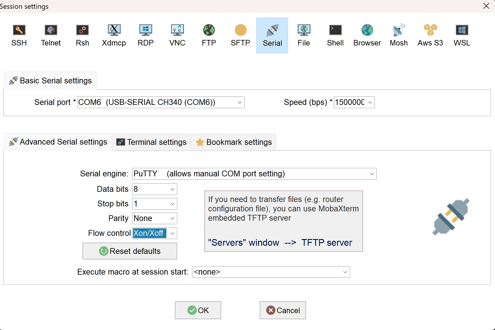
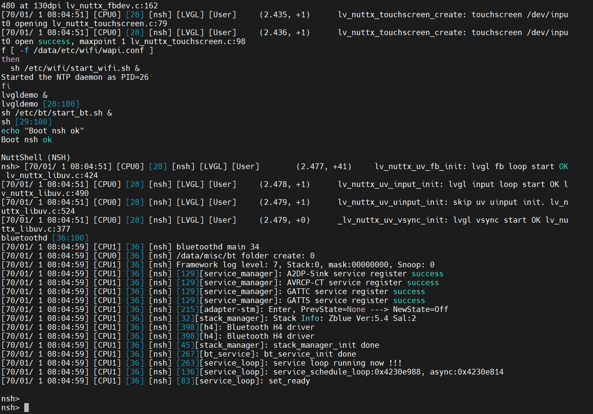

# 连接 R528 MIBOX-X1 开发板（串口与联网）
\[ [English](../../en/contest_hk_2026/mibox_x1_connect_guide.md) | 简体中文 | [繁體中文](./mibox_x1_connect_guide_zh-hk.md) \]

> 本文介绍烧录固件之后，怎样用 Windows 电脑通过串口连上 R528 MIBOX-X1 开发板，确认系统已经启动，并让开发板连上 Wi-Fi。串口工具以 MobaXterm 为例。烧录固件的步骤见[开发板使用指南](./mibox_x1_board_guide.md)第四节。

## 一、准备

### 1、硬件和接线

- 一块 R528 MIBOX-X1 开发板，已经烧录好固件。
- 一根 USB Type-A 转 Type-C 线，一头接电脑，另一头接开发板的 **12 号接口（UART0 调试串口）**。12 号口和烧录用的 11 号口（USB-D）都在板子右上角，12 号在左，11 号在右，不要接反。接口位置见[接口图](images/mibox_x1_interfaces.png)。
- 把拨码开关 **DIP4 拨到 ON**。DIP4 在 OFF 时，这组引脚用作 SD 卡，串口里不会有任何输出。

### 2、安装 CH340 驱动

开发板用 CH340 芯片把串口转成 USB，电脑需要安装对应的驱动。

1. 解压工具包里的 `CH341SER_Windows.zip`。
2. 用管理员权限运行 `SETUP.EXE`，点击「安装」。
3. 装好后，插上串口线，打开「设备管理器」，在「端口（COM 和 LPT）」下应该能看到 `USB-SERIAL CH340 (COMx)`，其中 `COMx` 是端口号（例如 COM6），记下它。

端口号会因电脑和 USB 口不同而变化。看不到这一项，说明驱动没装好，或者线没有接在 12 号口。

## 二、用 MobaXterm 连接串口

1. 先关闭所有可能占用这个 COM 口的程序（其他串口工具等）。一个 COM 口同一时间只能被一个程序打开。
2. 打开 MobaXterm，点击左上角的 **Session**，选择 **Serial**。
3. 按下表设置：

   | 设置项 | 取值 |
   | ------ | ---- |
   | Serial port | 上一步记下的 COM 口，例如 `COM6 (USB-SERIAL CH340 (COM6))` |
   | Speed (bps) | `1500000` |
   | Data bits | 8 |
   | Stop bits | 1 |
   | Parity | None |
   | Flow control | Xon/Xoff |

   Speed 下拉列表里不一定有 1500000，直接在输入框里输入即可。Data bits、Stop bits、Parity 和 Flow control 在 **Advanced Serial settings** 页签里。
4. 点击 **OK**，会话就打开了。
5. 按开发板上的 RESET 键（SW1，接口图 13 号），窗口里会滚动出开机日志。没有日志时，先在窗口里按一下回车。

下图是我们测试时的设置。图中 Speed 框里的数字显示不全，实际填的是 `1500000`，COM 口号会因电脑而不同。Flow control 我们用的是 Xon/Xoff，在这个设置下看到了完整的启动日志。



## 三、确认系统启动成功

开机日志里最后会出现 `Boot nsh ok`，随后是 NuttShell 的提示符 `nsh>`。下面是一段真实开发板的日志节选，具体行数、进程号和时间会因固件版本而不同：

```text
Started the NTP daemon as PID=26
lvgldemo &
...
echo "Boot nsh ok"
Boot nsh ok

NuttShell (NSH)
nsh>
```

下图是 MobaXterm 里看到的启动日志，从屏幕驱动开始，到 `nsh>` 结束：



日志里还能看到这些信息，可以用来判断各个部分是否正常：

| 日志内容 | 说明 |
| -------- | ---- |
| `lv_nuttx_fbdev` 相关行，含 `480 at 130dpi` | 屏幕驱动已启动，板子的屏幕上应有画面 |
| `touchscreen /dev/input0 opening success` | 触摸设备已打开，用手指点屏幕应有反应 |
| `lvgl fb loop start OK`、`lvgl input loop start OK` | LVGL 界面已运行 |
| `bluetoothd` 启动，`A2DP-Sink`、`GATTC`、`GATTS` 等服务 `register success` | 蓝牙协议栈已启动 |

注意：

- `nsh>` 之后，LVGL 和蓝牙的日志可能还在继续输出，把提示符冲到上面去。按一下回车，就会得到一个干净的 `nsh>`。
- 没有联网时，系统时间显示为 1970 年（日志前面的 `70/01/1`），这不是故障。

看到 `nsh>` 之后，可以先输入下面两条命令试一试：

```text
nsh> help
nsh> uname -a
```

`help` 列出可用的命令，`uname -a` 显示内核信息。

## 四、连接 Wi-Fi

开发板的 Wi-Fi 模组是 RTL8733BS，支持 2.4 GHz 和 5 GHz。下面的步骤让开发板作为客户端（STA）连接路由器或手机热点。以下命令在 `nsh>` 提示符下执行。

```text
nsh> ifup wlan0
nsh> wapi mode wlan0 2
nsh> wapi psk wlan0 <PSK> 3
nsh> wapi essid wlan0 <SSID> 1
nsh> renew wlan0
```

- `<PSK>` 换成 Wi-Fi 密码，`<SSID>` 换成 Wi-Fi 名称。
- `renew wlan0` 执行后会向路由器申请地址。
- 命令请一条一条输入。一次粘贴多行时，串口偶尔会丢字符。

连接成功后，用 `ping` 检查网络，可以 ping 路由器的网关地址，也可以 ping 外网地址：

```text
nsh> ping 8.8.8.8
```

收到回复就说明联网成功了。

按上面的命令连接后，重新上电需要把命令再输入一遍。开机脚本会检查 `/data/etc/wifi/wapi.conf`，这个文件存在时会自动启动 Wi-Fi，但怎样生成这个文件我们还没有验证，请先用上面的手动方式。5 GHz 网络也还没有在开发板上测试过，请先用 2.4 GHz 的网络。Wi-Fi 密码属于私人信息，在截图或日志里发给别人之前，请先把它遮住。

开发板也可以作为热点（AP 模式），命令见[开发板使用指南](./mibox_x1_board_guide.md)第五节的 Wi-Fi 部分。

## 五、常见问题

| 现象 | 先检查 |
| ---- | ------ |
| 设备管理器里没有 CH340，MobaXterm 的下拉列表里也没有 COM 口 | CH340 驱动是否已安装；线是否接在 12 号口；换一根线或换一个 USB 口 |
| 提示端口打不开或拒绝访问 | COM 口被其他程序占用，先关闭它们 |
| 窗口里有输出，但全是乱码 | Speed 是否是 `1500000`，数据位 8、停止位 1、校验 None |
| 窗口里没有任何输出 | DIP4 是否在 ON；线是否接在 12 号口；先按一下回车；再按 RESET 键 |
| 键盘输入没有反应，输出停住不动 | 按 RESET 键重新启动，再看日志；也可以把 Flow control 换成 None 试一下 |
| 烧录完成后开发板起不来 | 烧写线（11 号口）是否已经拔掉，见[开发板使用指南](./mibox_x1_board_guide.md)第四节 |

## 六、使用其他串口工具

串口参数与上面相同（1500000、8 位数据位、无校验、1 位停止位），所以 PuTTY、picocom 等工具也可以使用，只需要选对 COM 口或设备名。我们在 Windows 上实际使用并验证过的是 MobaXterm。
